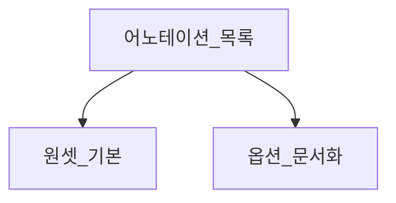

# 엔티티 어노테이션 목록

> **개요:** “쓸 수 있는 것”과 “원셋이 기본으로 쓰는 것”을 구분합니다.
> 세부 동작은 각 주제 글을 봅니다.

| 애너테이션 | 용도 | 원셋 |
|------------|------|------|
| `@Entity` | 영속 타입 | 사용 |
| `@Table` | 테이블명·유니크 | 사용 |
| `@Id` / `@GeneratedValue` | 식별자 | 사용 (단일 id 기본) |
| `@IdClass` / `@EmbeddedId` | 복합키 | 옵션. 파티션 원셋은 비권장 |
| `@Column` | 컬럼·null·unique·length | 사용 |
| `@ManyToOne` 등 | 연관 | 기본 아님. 스칼라 FK 우선 |
| `@Enumerated` / `@Converter` | enum | 컨버터·enum 템플릿 |
| `@DynamicInsert` / `@DynamicUpdate` | SQL 컬럼 생략 | Insert 사용 |
| `@EntityListeners` | 감사 등 | 호스트 |
| `@Version` | 낙관적 락 | 호스트 |

---

## 관련

- [연관과 cascade](/docs/knowledge/backend/entity/entity-associations)
- [식별자](/docs/knowledge/backend/entity/entity-identifiers)
- [enum 컨버터](/docs/knowledge/backend/entity/entity-enum-converter)
- [DynamicInsert·Update](/docs/knowledge/backend/entity/entity-dynamic-insert-update)
