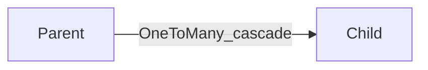

# 엔티티 연관과 cascade

> **개요:** JPA 연관과 cascade를 쓸 수 있습니다.
> 원셋·db-design은 **스칼라 FK를 기본**으로 두고, `@ManyToOne`을 기본값으로 두지 않습니다 ([관계와 조회](/docs/harness/templates/backend/spring/db-design/relations-and-dto)).
> 원셋 결론: [최소 사용과 CQRS](/docs/knowledge/backend/entity/entity-minimal-and-cqrs).

---

## 연관 종류

| 애너테이션 | 의미 |
|------------|------|
| `@ManyToOne` | 다대일 |
| `@OneToMany` | 일대다 (보통 역방향) |
| `@OneToOne` | 일대일 |
| `@ManyToMany` | 다대다 (중간 테이블) |

양방향이면 **연관 주인**(FK를 가진 쪽)을 명확히 합니다.
cascade(`PERSIST`, `MERGE`, `REMOVE`, `ALL` …)는 부모 저장이 자식을 끌고 갑니다.
편리한 만큼 삭제·영속 범위가 커집니다.

---

## 원셋 쪽

- 컬럼은 `org_id` 같은 스칼라를 우선합니다
- 필요 시 스칼라 + `@ManyToOne`(insertable/updatable false) 이중은 호스트 선택
- 목록에 전 그래프를 올리지 않습니다 — Facade가 Item만 조립

---

## 관련

- [LAZY·EAGER](/docs/knowledge/backend/entity/entity-fetch-lazy-eager)
- [EntityGraph](/docs/knowledge/backend/entity/entity-entitygraph)
- [최소 사용과 CQRS](/docs/knowledge/backend/entity/entity-minimal-and-cqrs)
