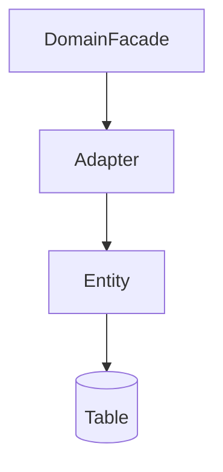

# 엔티티 설계

> **개요:** 엔티티는 DB 행에 가까운 영속 모델입니다.
> Facade·API 밖으로 객체 그래프를 흘리지 않습니다.
> JPA 기능을 많이 쓸 수 있지만, 원셋 결론은 [최소 사용과 CQRS](/docs/knowledge/backend/entity/entity-minimal-and-cqrs)입니다.
> 구현 복사는 원셋 entity입니다. **하네스 필수 읽기나 원셋 복사 경로에는 넣지 않습니다.**

## 책임

- 테이블 컬럼과 식별자
- soft delete 등 행 수준 상태 (호스트 관례)
- 감사 필드·DynamicInsert로 DEFAULT 존중
- Adapter 안에서만 다루기. Controller·BFF가 entity를 보지 않음

## 하위 글

모델 발전 → 어노테이션·연관·Id·컨버터·로딩·EntityGraph·더티·Dynamic*·제약 → **minimal-and-cqrs**.

목록은 [Entity index](/docs/knowledge/backend/entity/index)와 같습니다.

## 관련

- [Repository](/docs/knowledge/backend/repository/index)
- [유스케이스와 DTO](/docs/harness/templates/backend/spring/db-design/usecase-dto)
- [CQRS](/docs/patterns/architecture-patterns/cqrs)
