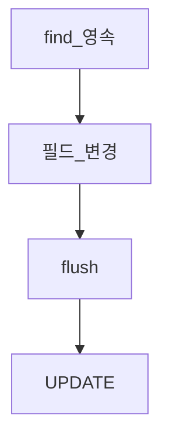

# 더티 체킹

> **개요:** 영속 상태 엔티티의 필드가 바뀌면 플러시 시 UPDATE가 나갑니다.
> “항상 update 메서드를 호출해야 한다”는 오해와, 원셋 `BeanUtils.map` 부분 수정을 맞춥니다.

원셋 `saveById`는 로드 후 `BeanUtils.map(update, entity)`로 null/blank가 아닌 값만 반영합니다.
TX 안에서 영속이면 더티 체킹이 UPDATE를 만듭니다.
Adapter가 Facade TX에 join하는 전제는 [Service — TX join](/docs/knowledge/backend/service/service-tx-join-facade)입니다.

원셋 결론: [최소 사용과 CQRS](/docs/knowledge/backend/entity/entity-minimal-and-cqrs).

---

## 관련

- [DynamicInsert·Update](/docs/knowledge/backend/entity/entity-dynamic-insert-update)
