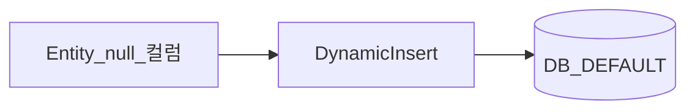

# DynamicInsert와 DynamicUpdate

> **개요:** null 컬럼을 SQL에서 빼 DEFAULT·트리거를 살립니다.
> 원셋 ExampleItem은 `@DynamicInsert`를 씁니다.

| | DynamicInsert | DynamicUpdate |
|--|---------------|---------------|
| 시점 | INSERT | UPDATE |
| 효과 | null 컬럼 생략 | 변경 컬럼만 |

DB `DEFAULT`가 있는 컬럼에 필드 초기값·`@Builder.Default`를 두지 않는 관례는 coding-conventions Persistence와 같습니다.

원셋 결론: [최소 사용과 CQRS](/docs/knowledge/backend/entity/entity-minimal-and-cqrs).

---

## 관련

- [더티 체킹](/docs/knowledge/backend/entity/entity-dirty-checking)
