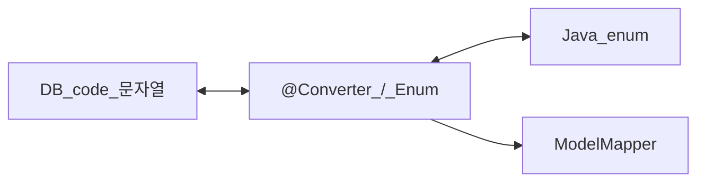

# 엔티티 enum 컨버터

> **개요:** DB 코드 문자열과 Java enum을 잇습니다.
> 원셋은 [enum 템플릿](/docs/harness/templates/backend/spring/enum/)의 `_Enum` + `@Converter(autoApply = true)` + ModelMapper 등록입니다.

`@Enumerated(EnumType.STRING/ORDINAL)`만으로 부족한 코드표·마이그레이션은 AttributeConverter로 가져갑니다.
생성 클래스 static 블록이 ModelMapper에 enum↔code를 등록하는 흐름은 enum README를 따릅니다.
DTO에는 enum.name()을 저장하지 않고 `getCode()` 문자열을 쓰는 관례는 coding-conventions와 같습니다.

원셋 결론: [최소 사용과 CQRS](/docs/knowledge/backend/entity/entity-minimal-and-cqrs).

---

## 관련

- [enum 템플릿](/docs/harness/templates/backend/spring/enum/)
- [어노테이션 목록](/docs/knowledge/backend/entity/entity-annotations-catalog)
