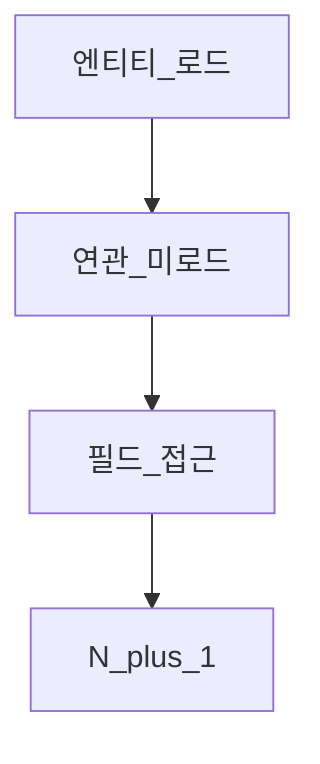

# LAZY와 EAGER

> **개요:** 연관 기본 fetch를 EAGER로 두면 목록이 무거워집니다.
> 원셋은 스칼라 FK·Spec 조회를 우선하고, 필요 연관만 유스케이스에서 조립합니다.

| | LAZY | EAGER |
|--|------|-------|
| 시점 | 접근 시 로드 | 엔티티 로드 시 |
| 위험 | LazyInitializationException, N+1 | 과다 조인·메모리 |

fetch join·배치 사이즈·EntityGraph로 완화할 수 있습니다.
그래도 “전 그래프를 엔티티에 박기”는 원셋이 피합니다 → [최소 사용과 CQRS](/docs/knowledge/backend/entity/entity-minimal-and-cqrs), [EntityGraph](/docs/knowledge/backend/entity/entity-entitygraph).

---

## 관련

- [연관과 cascade](/docs/knowledge/backend/entity/entity-associations)
