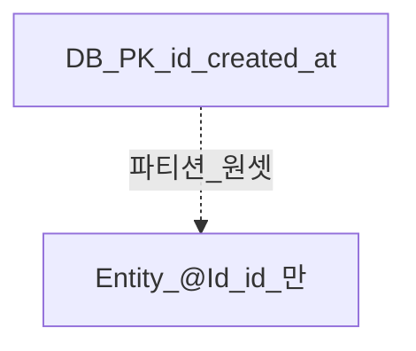

# 엔티티 식별자

> **개요:** JPA는 단일 `@Id`, `@IdClass`, `@EmbeddedId`를 제공합니다.
> 파티션 원셋은 DB 복합 PK여도 엔티티는 **id만 `@Id`** ([partitioning](/docs/harness/templates/backend/spring/db-design/partitioning.md)).

| 방식 | 언제 |
|------|------|
| `@Id` + 생성 전략 | 기본 |
| `@IdClass` | 복합키를 별도 클래스로 |
| `@EmbeddedId` / `@Embeddable` | 임베디드 키 타입 |

원셋 기본은 단일 id입니다.
복합키 옵션은 문서화하되 파티션·일반 CRUD 기본 경로에 강제하지 않습니다.

원셋 결론: [최소 사용과 CQRS](/docs/knowledge/backend/entity/entity-minimal-and-cqrs).

---

## 관련

- [어노테이션 목록](/docs/knowledge/backend/entity/entity-annotations-catalog)
