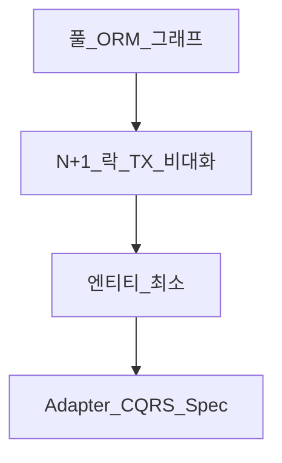

# 엔티티 최소 사용과 CQRS

> **개요:** cascade·EntityGraph·더티체킹을 다 쓸 수 있습니다.
> 원셋은 그 유혹을 지나 **엔티티·JPA 기능을 최소로** 두고, 조회/변경을 Adapter의 CQRS 관점으로 정리합니다.
> 허브는 [엔티티 설계](/docs/knowledge/backend/entity/entity-design)입니다.

---

## 유혹과 비용

연관·cascade·EntityGraph를 엔티티에 잔뜩 올리면 “한 번에 다 가져오기”가 쉬워 보입니다.
목록·상세·안전 조회가 한 그래프에 묶이고, Facade가 연관을 끊기도 어렵습니다.

---

## 원셋 선택

| 한다 | 하지 않는다 (기본) |
|------|-------------------|
| 스칼라 FK, Spec/`Filter` 조회 | 엔티티에 전 연관 EAGER |
| Adapter에서 map·부분수정 | Controller에 entity |
| 필요 시 Read/Command Provider | Facade가 데이터소스 선택 |
| DynamicInsert로 DEFAULT | 복합키를 파티션 기본으로 |

CQRS 적용점은 **JPA Adapter**입니다 ([CQRS](/docs/patterns/architecture-patterns/cqrs), [Provider와 CQRS](/docs/knowledge/backend/service/service-provider-and-cqrs)).
Facade는 Port만 봅니다.

기능별 글(연관, EntityGraph, 더티…) 말미의 “원셋 기본은 최소”가 이 글을 가리킵니다.

---

## 관련

- [엔티티 설계](/docs/knowledge/backend/entity/entity-design)
- [Facade — 진입과 이름](/docs/knowledge/backend/facade/facade-entry-and-naming)
- [Repository 세 인터페이스](/docs/knowledge/backend/repository/repository-three-interfaces)
