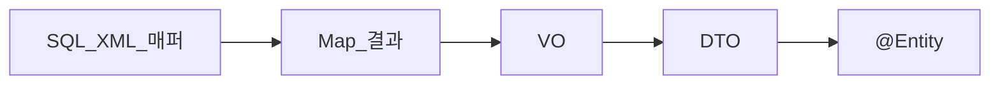

# 영속 모델 발전사 — XML에서 ORM까지

> **개요:** 결과를 무엇으로 담아 왔는지의 타임라인입니다.
> 빈 주입 발전은 [Service — XML·매퍼 주입](/docs/knowledge/backend/service/service-di-xml-and-mapper)입니다.

| 단계 | 이득 | 고통 |
|------|------|------|
| XML/SQL 매퍼 | SQL 명시 | XML·자바 이중 관리 |
| `Map` | 빠름 | 키 오타, 타입 없음, 리팩터 불가 |
| VO | 필드 고정 | 계층마다 복제, 의미 혼재 |
| DTO | 전송·API 계약 분리 | 매핑 비용 |
| ORM Entity | 행↔객체, 변경 추적 | 그래프·N+1·TX 과다 유혹 |

원셋은 Entity를 쓰되 **최소로** 두고, API에는 Item/DTO만 내보냅니다.
결말은 [최소 사용과 CQRS](/docs/knowledge/backend/entity/entity-minimal-and-cqrs)입니다.

---

## 관련

- [VO·DTO·Entity](/docs/knowledge/backend/entity/persistence-vo-dto-entity)
- [엔티티 설계](/docs/knowledge/backend/entity/entity-design)
