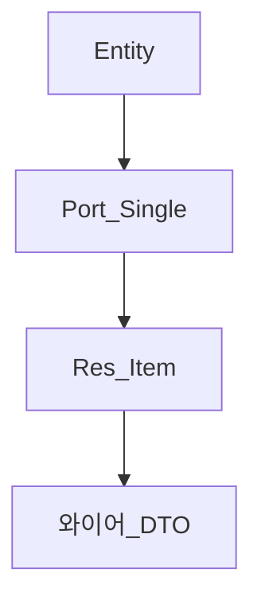

# VO·DTO·Entity

> **개요:** 같은 “객체”라도 계층마다 이름이 다릅니다.
> [유스케이스와 DTO](/docs/harness/templates/backend/spring/db-design/usecase-dto)와 맞춥니다.

| 이름 | 이 아카이브에서의 자리 |
|------|------------------------|
| Entity | JPA 영속 행. Adapter 안 |
| Port DTO / Single | Port가 주고받는 스칼라 위주 |
| Res.Item 등 | 유스케이스가 약속한 응답. 연관은 여기만 |
| 와이어 DTO | HTTP·GraphQL 필드명. Facade/BFF에서 교환 |
| VO (옛 말) | 값 묶음. 지금은 DTO·Item으로 역할을 나눔 |

Entity를 Controller나 BFF에 올리지 않습니다.
Facade가 Item 계약만큼만 조립합니다.

---

## 관련

- [영속 모델 발전사](/docs/knowledge/backend/entity/persistence-from-xml-to-orm)
- [Facade — 진입과 이름](/docs/knowledge/backend/facade/facade-entry-and-naming)
