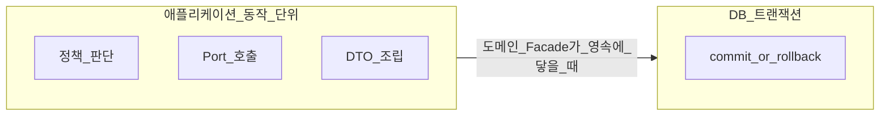
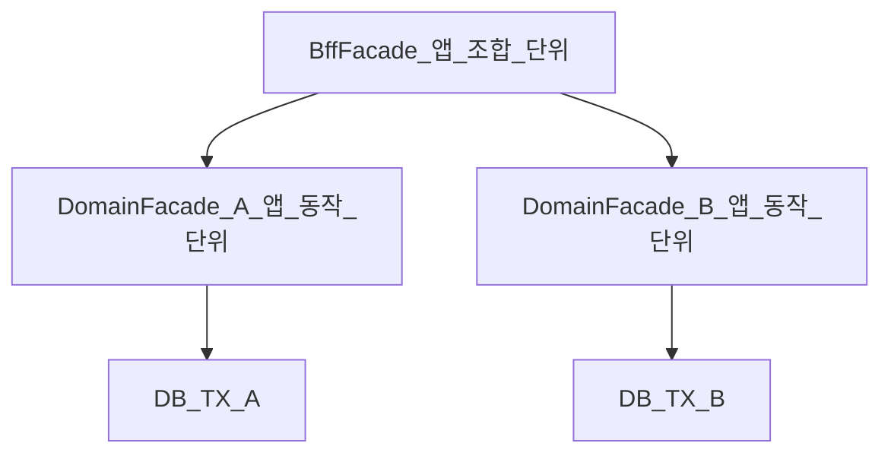
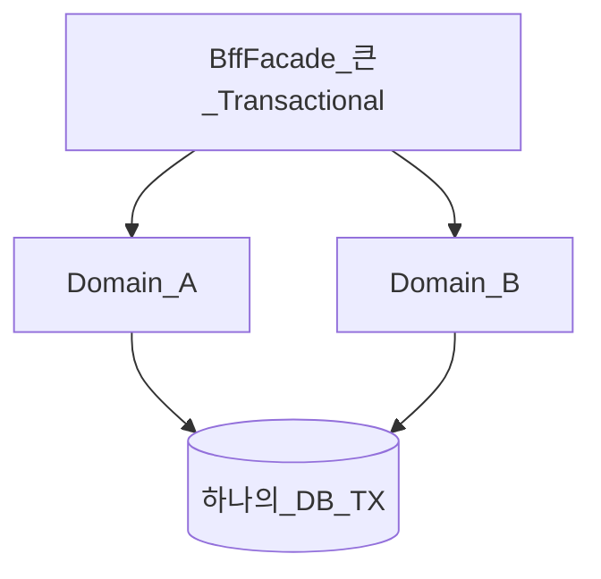

# Facade — 앱 동작 단위와 트랜잭션

> **개요:** BFF Facade와 도메인(유스케이스) Facade를 나눈 **가장 큰 이유**는 DB 어노테이션이 아니라 애플리케이션 동작 단위입니다.
> 허브는 [애플리케이션 영역과 Facade](/docs/knowledge/backend/facade/facade-design)입니다.

---

## 애플리케이션 트랜잭션 ≠ DB 트랜잭션

| | 의미 | 이 아카이브에서의 자리 |
|--|------|------------------------|
| 애플리케이션 트랜잭션 | “이번 동작이 앱에서 어디까지가 한 단위인가” (성공·실패·보상·조합 범위) | Facade가 소유하는 **동작 경계** |
| DB 트랜잭션 | DB가 commit/rollback으로 묶는 단위 (`@Transactional` 등) | 도메인 Facade 동작이 영속에 닿을 때 Adapter가 **join**하는 구현 수단 |

둘을 같은 말로 쓰면, BFF 시나리오 전체를 한 DB TX로 묶는 설계가 “자연스러워” 보입니다.
실제로는 락 범위·롤백 의미·도메인 소유가 섞입니다.



---

## 그래서 Facade 레이어를 둘로 나눈다

| | 도메인 Facade | BFF Facade |
|--|---------------|------------|
| 앱 동작 단위 | 한 도메인의 유스케이스 | 화면·시나리오 **조합** |
| DB TX | 그 단위에 맞추는 것이 기본 | 여러 도메인을 **한 DB TX로 승격하지 않음** |
| 의존 | Port | 도메인 진입만 |



도메인 Facade가 그 도메인 변경의 로컬 DB TX 경계를 엽니다.
JPA Adapter는 그 TX에 join합니다 ([coding-conventions Transactions](/docs/harness/context/coding-conventions)).

BFF는 여러 도메인 진입을 시나리오 순서로 호출할 뿐입니다.
부분 실패를 전체 실패로 볼지, 일부 결과만 줄지는 **BFF의 앱 단위 정책**입니다.
그 정책을 “더 큰 `@Transactional`”로 대체하지 않습니다.

프로세스 밖 다중 변경의 앱 완수는 [Saga](/docs/patterns/architecture-patterns/saga)입니다.
BFF 로컬 DB TX로 분산 완수를 흉내 내지 않습니다.

조회 조합이 느린 것은 BFF·조립 이슈일 수 있습니다.
TX 이야기와 구분해 적습니다 ([ONESET](/docs/harness/templates/backend/spring/ONESET)).

---

## 안티패턴: BFF에 큰 DB TX



이렇게 하면:

- 서로 다른 도메인 락·롤백이 한 덩어리가 됩니다
- 도메인 Facade가 연 동작 단위의 의미가 흐려집니다
- 모니터링·재시도·부분 성공 UI와 어긋나기 쉽습니다

BFF가 DomainPort를 직접 보는 것도 같은 계열입니다.
도메인 TX·정책·표시명 조립을 우회합니다.

---

## 구현 메모: `@Transactional` (정의가 아님)

원셋·컨벤션:

- Facade와 JPA Adapter 클래스 기본: `@Transactional(readOnly = true, transactionManager = "transactionManager")`
- 쓰기 메서드만 `@Transactional`로 오버라이드
- Adapter TX는 Facade에 **join**
- Controller에서 TX를 시작하지 않음

```java
@Transactional(readOnly = true, transactionManager = "transactionManager")
public class ExampleItemFacade {
    @Transactional // 쓰기
    public ExampleItemRes.Id save(ExampleItemReq.Create req) { /* ... */ }
}
```

이 규칙은 **도메인 앱 단위가 DB에 닿을 때의 구현**입니다.
“BFF와 도메인을 나눈 정의” 자체가 아닙니다.
Adapter 쪽 join·전파 세부는 Service Knowledge의 TX 섹터에서 이어 씁니다.

catch로 예외를 삼키고 정상 반환하면 앱 단위는 성공처럼 보이는데 DB는 롤백됐을 수 있습니다.
그 함정은 [Controller Advice — 예외 전파](/docs/knowledge/backend/controller/advice-exception-propagation)와 맞물립니다.

---

## 관련

- [애플리케이션 영역과 Facade](/docs/knowledge/backend/facade/facade-design) (허브)
- [진입과 이름](/docs/knowledge/backend/facade/facade-entry-and-naming)
- [테스트와 실패 정책](/docs/knowledge/backend/facade/facade-testing-and-failures)
- [coding-conventions — Transactions](/docs/harness/context/coding-conventions)
- [Saga](/docs/patterns/architecture-patterns/saga)
- [CQRS](/docs/patterns/architecture-patterns/cqrs)
