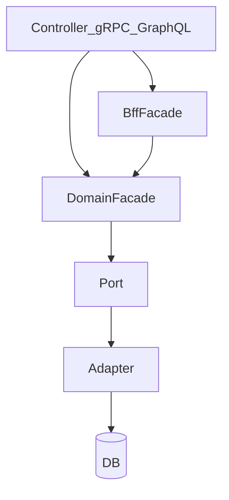

# 애플리케이션 영역과 Facade

> **개요:** 애플리케이션 영역의 공개 진입점 Knowledge 입구입니다.
> 이름은 GoF Facade에서 왔고, 이 아카이브에서는 경량 헥사의 유스케이스 조립 층입니다.
> 구현 복사·검증은 원셋과 coding-conventions입니다 ([ADR-0010](/docs/decisions/adr-0010)).
> **하네스 필수 읽기나 원셋 복사 경로에는 넣지 않습니다.** 깊이 필요할 때만 읽습니다.
> 세부 서사는 아래 하위 글에 둡니다.

## 한 줄로

| 질문 | 답 |
|------|-----|
| 왜 이름이 Facade인가 | GoF Facade: 하위 복잡함을 가린 공개 면 |
| 헥사에서 어디인가 | 라이트 헥사 **UseCase와 같은 층** (이름만 Facade) |
| BFF와 도메인을 왜 나누나 | **애플리케이션 동작 단위**가 다르기 때문 (DB `@Transactional`이 정의가 아님) |
| DTO 연관은 | Facade가 Item 계약만큼만 조립. 전 그래프를 밖으로 안 흘림 |

Port·Adapter·Provider 세부는 [데이터 접근 경계](/docs/knowledge/backend/service/service-design)로 갑니다.

## 하위 글

| 글 | 다루는 것 |
|----|-----------|
| [진입과 이름 (GoF·경량 헥사·연관 끊기)](/docs/knowledge/backend/facade/facade-entry-and-naming) | 이름 유래, UseCase 동치, Item 조립, api/model, DisplayNameResolver |
| [앱 동작 단위와 트랜잭션](/docs/knowledge/backend/facade/facade-app-unit-and-transactions) | 앱 TX ≠ DB TX, BFF vs 도메인, `@Transactional` 구현·안티패턴 |
| [테스트와 실패 정책](/docs/knowledge/backend/facade/facade-testing-and-failures) | Port 스텁, 부분 실패, Saga 경계 |

## 관련

- [Controller Design](/docs/knowledge/backend/controller/controller-design)
- [데이터 접근 경계 (Port와 Adapter)](/docs/knowledge/backend/service/service-design)
- [유스케이스와 DTO](/docs/harness/templates/backend/spring/db-design/usecase-dto)
- [CQRS](/docs/patterns/architecture-patterns/cqrs)
- [ADR-0010](/docs/decisions/adr-0010)
- 원셋: `docs/harness/templates/backend/spring/exampleitem/facade/`
