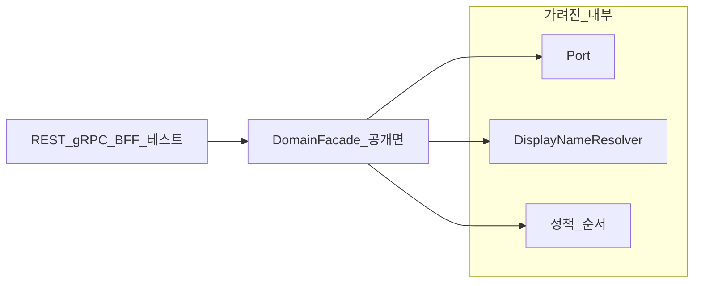
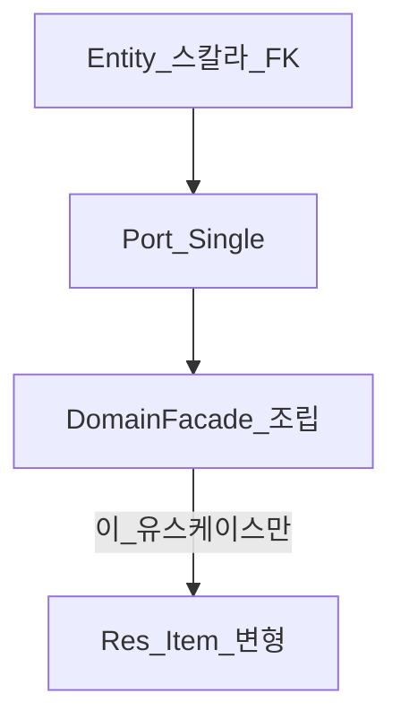
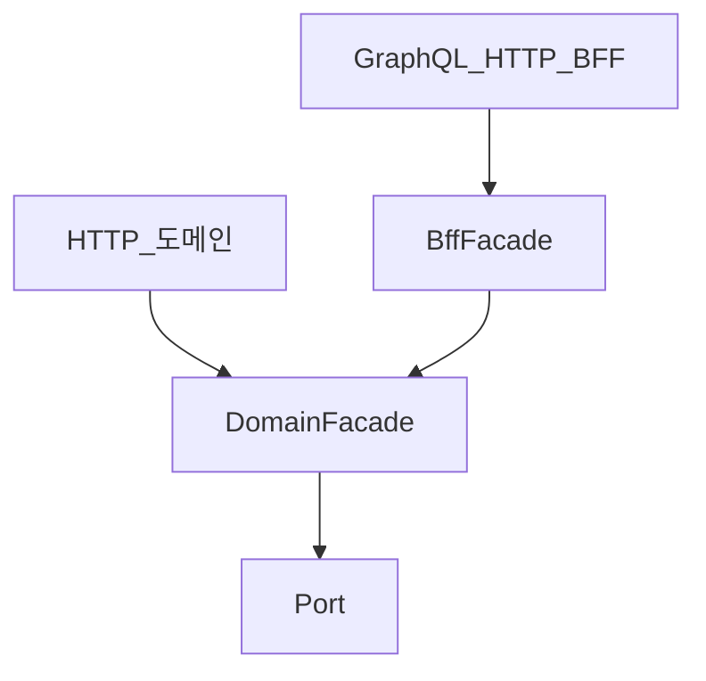

# Facade — 진입과 이름

> **개요:** 왜 클래스 접미사가 Facade인지, 경량 헥사에서 어디에 해당하는지, 하위 DTO 연관을 어떻게 끊는지를 적습니다.
> 허브는 [애플리케이션 영역과 Facade](/docs/knowledge/backend/facade/facade-design)입니다.

---

## 이름은 GoF Facade에서

GoF 구조 패턴 **Facade**는 복잡한 하위 시스템에 대해 **단순한 공개 API**를 줍니다.
호출자는 Port·Spec·여러 협력자를 직접 조율하지 않고, 진입면 하나와 이야기합니다.

이 아카이브의 `{Domain}Facade`도 같은 취지입니다.
임의로 붙인 레이어 라벨이 아니라, “도메인 서브시스템의 공개 면”이라는 뜻을 이름에 실은 것입니다.

헥사고날의 애플리케이션 서비스(유스케이스 경계)와 역할이 겹치는 경우가 많습니다.
바깥 어댑터(REST, gRPC, CLI)가 재사용하는 **앱 경계**가 그 자리입니다.
우리는 그 경계의 **기본 이름**을 Facade로 둡니다 ([ADR-0010](/docs/decisions/adr-0010)).

Manager·Checker 등으로 바꿀 때는 이름이 예뻐서가 아니라, **책임이 ‘단순 진입면·유스케이스 조립’과 다를 때**만 바꿉니다.
이름만 보고 Facade를 일괄 개명하지 않습니다.

---

## 경량 헥사에서는 UseCase와 같은 층

Spring 원셋의 DomainFacade는 라이트 헥사의 **UseCase와 같은 층**입니다.
이름만 다릅니다.

| 라이트 헥사 | Spring 원셋 |
|-------------|-------------|
| UseCase | DomainFacade |
| Outbound Port | `*Port` + Adapter |
| DTO / View model | `{Domain}Req` / `{Domain}Res` 사다리·Item 변형 |

근거와 Item 사다리는 [유스케이스와 DTO](/docs/harness/templates/backend/spring/db-design/usecase-dto)에 이미 있습니다.
Flutter 원셋의 UseCase와도 같은 역할 축입니다.

하는 일:

- Port 호출 순서와 정책
- 이 유스케이스가 약속한 DTO만 조립
- (도메인 진입이면) 조회 직후 DisplayNameResolver

하지 않는 일:

- Repository·entity·Spec을 직접 만지기
- 다른 도메인 Adapter를 직접 호출하기
- 와이어 JSON 스키마를 Adapter에 떠넘기기 (교환은 유스케이스 진입)

---

## 하위 DTO 연관을 끊는 레이어

Entity·테이블 행과 Port `Single`은 스칼라·FK id 위주입니다.
전 객체 그래프를 API 밖으로 흘리면 목록·상세·안전 조회가 한 덩어리로 묶입니다.

DomainFacade는 **Item / ItemFor…** 계약에 맞는 연관만 로드·조립합니다.
“한 번에 전 연관을 fetch해 두고 Item만 자른다”는 하지 않습니다.

와이어 DTO(화면 필드명 Req)와 Port DTO가 다르면 **유스케이스 진입**(도메인 또는 BFF)에서 교환합니다.
Adapter는 와이어를 몰라도 됩니다.

세부는 usecase-dto를 보고, 이 글은 “왜 Facade가 끊는가”만 고정합니다.

---

## 도메인 진입과 BFF 진입

| | 도메인 애플리케이션 진입 | BFF 애플리케이션 진입 |
|--|-------------------------|----------------------|
| 책임 | 도메인 속성 유스케이스·정책 | 여러 도메인 진입을 묶어 화면·시나리오 조립 |
| 이름 | 기본 Facade | 기본 예 `{Feature}BffFacade` (호스트명 유지 가능) |
| 모노리포 | **model** | **api** |
| 모놀리식 | 도메인 `facade/` | 앱 BFF·feature |
| 의존 | 자기 Port + DisplayNameResolver | **도메인 진입만** (Port 없음) |
| 호출 | gRPC, HTTP 도메인 | GraphQL, HTTP BFF |

BFF 전용 Port를 만들지 않습니다.
영속 계약은 Port이고, 다른 앱·BFF가 부르는 공개 표면은 도메인 진입입니다.

표시명만 담당하는 `UserNameFacade`는 두지 않습니다.
`DisplayNameResolver`를 model(또는 도메인 `support/display`)에 두고, 도메인 조회 Facade가 Name 맵을 붙입니다.

두 진입을 **애플리케이션 동작 단위**로 나누는 이유는 [앱 동작 단위와 트랜잭션](/docs/knowledge/backend/facade/facade-app-unit-and-transactions)에 둡니다.

---

## 이름 표 (참고)

| 이름 | 고를 때 |
|------|---------|
| Facade | 공개 진입점의 기본 |
| Manager | 수명주기·상태 갱신을 소유할 때 |
| Checker | 통과/거절만, 흐름을 소유하지 않을 때 |
| Handler | 이벤트·메시지·단일 처리에 가까울 때 |
| Processor | 파이프라인 성격이 강할 때 |
| Resolver | 표시·해석 헬퍼 (`DisplayNameResolver`) |

닫힌 허용 목록이 아닙니다.
역할이 분명할 때만 바꿉니다.

---

## 관련

- [애플리케이션 영역과 Facade](/docs/knowledge/backend/facade/facade-design) (허브)
- [앱 동작 단위와 트랜잭션](/docs/knowledge/backend/facade/facade-app-unit-and-transactions)
- [유스케이스와 DTO](/docs/harness/templates/backend/spring/db-design/usecase-dto)
- [ONESET](/docs/harness/templates/backend/spring/ONESET)
- [coding-conventions](/docs/harness/context/coding-conventions)
