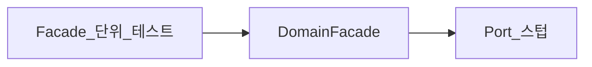
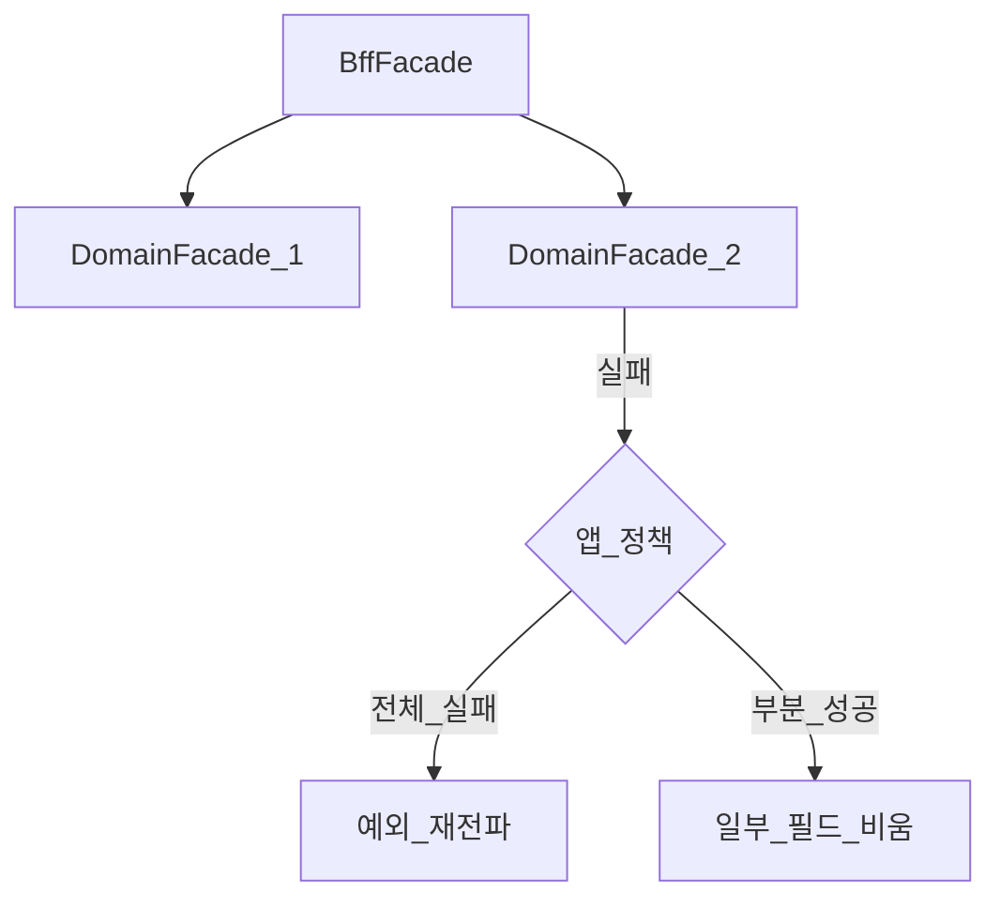

# Facade — 테스트와 실패 정책

> **개요:** Facade 단위 테스트는 Port(또는 도메인 진입)를 대체해 앱 동작 단위를 검증합니다.
> 허브는 [애플리케이션 영역과 Facade](/docs/knowledge/backend/facade/facade-design)입니다.

---

## 테스트 경계

| 대상 | 대체(스텁·목) | 확인 |
|------|---------------|------|
| DomainFacade | Port | 조합, 정책, 분기, 표시명, 실패 시 예외 |
| BffFacade | 도메인 진입 | 화면·시나리오 조립, DTO 교환, 부분 실패 정책 |
| JPA Adapter | Repository | 매핑·Spec — Facade 테스트가 아님 |

Mockito를 쓰면 **다음 층만** 목합니다.
Facade 테스트가 Repository를 직접 목하면 Adapter 경계를 건너뛴 것입니다 ([coding-conventions](/docs/harness/context/coding-conventions)).

미실행 테스트를 통과로 적지 않습니다.
공통 구조는 [테스트 기본 구조](/docs/knowledge/backend/testing/test-structure)를 봅니다.

---

## 실패 정책은 앱 동작 단위의 일부

DomainFacade에서 Port가 없으면 `BizErrorException` 등으로 **그 유스케이스 단위**가 실패합니다.
Advice가 HTTP로 바꿉니다.

BffFacade는 여러 도메인 진입을 부릅니다.

| 정책 | 예 |
|------|-----|
| 전체 실패 | 한 도메인이라도 실패하면 시나리오 실패 |
| 부분 성공 | 주 도메인 성공, 부가 조회 실패 시 필드만 비움·경고 코드 |
| 재시도·보상 | 원격 변경이 섞이면 Saga·메시징 쪽 |

정책을 catch로 숨기지 않습니다.
삼키고 200을 주면 [앱 동작 단위](/docs/knowledge/backend/facade/facade-app-unit-and-transactions)가 깨집니다.

---

## Saga와의 경계

같은 프로세스의 로컬 변경은 도메인 Facade + DB TX로 충분할 수 있습니다.
**다른 프로세스·서비스의 변경을 한 앱 단위로 완수**해야 하면 Saga입니다.

BffFacade에 긴 DB TX를 씌워 분산 완수를 흉내 내지 않습니다.
일반 설명은 [Saga](/docs/patterns/architecture-patterns/saga), 레시피는 [spring-messaging-saga](/docs/harness/orchestrations/spring-messaging-saga)입니다.

조회만 조합하는 BFF에는 Saga를 쓰지 않습니다.

---

## 스모크로 볼 것

| 보고 싶은 것 | 예 |
|--------------|-----|
| 없는 자원 | Port가 empty → 업무 예외 코드 |
| 표시명 | Resolver가 Name 맵을 붙이는지 (Port `findAllName` 스텁) |
| BFF 부분 실패 | 한 도메인 스텁이 예외 → 정책대로 동작 |
| 쓰기 TX | 시나리오·슬라이스에서 롤백 (단위 Facade만으로 부족하면 통합) |

---

## 관련

- [애플리케이션 영역과 Facade](/docs/knowledge/backend/facade/facade-design) (허브)
- [앱 동작 단위와 트랜잭션](/docs/knowledge/backend/facade/facade-app-unit-and-transactions)
- [테스트 기본 구조](/docs/knowledge/backend/testing/test-structure)
- [Saga](/docs/patterns/architecture-patterns/saga)
