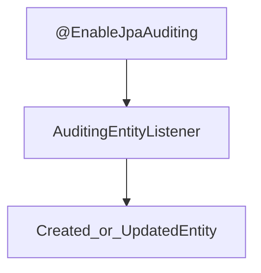

# Repository — Auditing

> **개요:** 누가·언제 만들고 바꿨는지를 엔티티에 자동으로 채우는 Spring Data **Auditing**입니다.
> 어노테이션·활성화와 원셋 `CreatedEntity` / `UpdatedEntity` 자리를 연결합니다.
> **하네스 필독 아님.** DB 설계 쪽 상속 규칙은 [db-design Audit](/docs/harness/templates/backend/spring/db-design/audit)이 SSOT에 가깝습니다.

공식 「Auditing」 축을 이 아카이브 선택으로 다시 씁니다.

---

## 메타데이터 어노테이션

| 어노테이션 | 의미 |
|------------|------|
| `@CreatedDate` | 생성 시각 |
| `@LastModifiedDate` | 수정 시각 |
| `@CreatedBy` | 생성자 |
| `@LastModifiedBy` | 수정자 |

날짜 타입은 `LocalDateTime`, `Instant` 등 지원 범위 안입니다.
**누가**를 쓰려면 `AuditorAware` 빈이 필요합니다.
날짜만 필요하면 `AuditorAware` 없이도 동작하는 구성이 가능합니다.

---

## 활성화

1. 설정에 `@EnableJpaAuditing` (또는 동등 XML)
2. 엔티티(또는 상위타입)에 `AuditingEntityListener` 등록
3. (선택) `AuditorAware<…>` — 보안 컨텍스트의 사용자명 등

원셋 `BaseEntity`는 `AuditingEntityListener`와 호스트용 `BaseEntityListener`를 함께 둡니다.
support README를 봅니다.



---

## 원셋 상속

```text
BaseEntity
 └── CreatedEntity      created_at, created_by   (@CreatedDate, @CreatedBy)
      └── UpdatedEntity  + updated_at, updated_by, version
                         (@LastModifiedDate, @LastModifiedBy, @Version)
```

| 타입 | 컬럼 요지 | 쓰는 테이블 |
|------|-----------|-------------|
| `CreatedEntity` | 생성 감사 | 이력·로그·통계, ExampleItem 기본 |
| `UpdatedEntity` | 생성+수정+**version** | 변경·낙관적 락이 필요한 마스터 |

`@Version`은 Auditing 어노테이션이 아니라 **낙관적 락** 재료입니다.
수정 감사와 함께 `UpdatedEntity`에 두는 원셋 선택입니다 → [Locking](/docs/knowledge/backend/repository/repository-locking).

템플릿 코드: [CreatedEntity](/docs/harness/templates/backend/spring/support/), [UpdatedEntity](/docs/harness/templates/backend/spring/support/).
테이블 역할별 상속: [db-design Audit](/docs/harness/templates/backend/spring/db-design/audit).

---

## Repository와의 관계

Auditing은 **리포지토리 메서드 API가 아니라** 엔티티 리스너·영속화 시점에 채워집니다.
`save`가 나갈 때 리스너가 날짜·작성자를 넣습니다.

벌크 `@Modifying` 쿼리는 리스너를 건너뛸 수 있습니다.
감사 컬럼·version이 중요하면 벌크 대신 엔티티 로드 후 변경을 검토합니다.

---

## 함정

- `@EnableJpaAuditing`만 켜고 Listener·상위타입을 안 붙이면 필드가 비어 있거나 null 제약에 걸립니다.
- `updatable = false`인 `created_*`를 애플리케이션에서 덮어쓰지 마세요.
- 로그성 테이블에 `UpdatedEntity`+version을 붙이는 drift는 db-design follow-ups에서 경계합니다.
- 감사 “누가”와 보안 주체가 어긋나면 `AuditorAware` 구현을 먼저 의심합니다.

---

## 관련

- [db-design Audit](/docs/harness/templates/backend/spring/db-design/audit)
- [support CreatedEntity / UpdatedEntity](/docs/harness/templates/backend/spring/support/)
- [Locking](/docs/knowledge/backend/repository/repository-locking)
- [Repository 설계](/docs/knowledge/backend/repository/repository-design)
