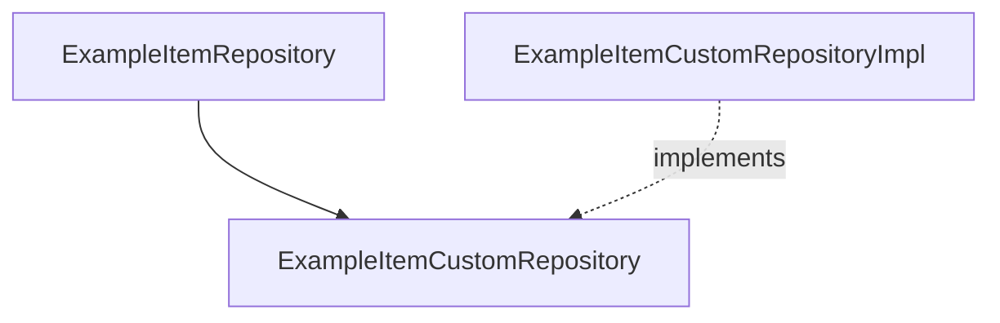

# 커스텀 Repository

> **개요:** Spring Data가 생성하지 않는 조회는 `…Custom` + `…Impl`로 엽니다.
> 원셋은 빈 Custom이어도 **자리**를 유지합니다.

규칙 요지:

- 인터페이스 이름 `XxxCustomRepository`(또는 호스트 관례)
- 구현 `XxxCustomRepositoryImpl` — 스프링 데이터가 찾아 붙임
- Impl을 수동 `@Bean`으로 또 등록하지 않는 것이 보통

Impl에 `JPAQueryFactory`를 두면 QueryDSL 동적 쿼리로 이어집니다 → [QueryDSL Custom](/docs/knowledge/backend/repository/repository-querydsl-custom).

---

## 관련

- [세 인터페이스 조립](/docs/knowledge/backend/repository/repository-three-interfaces)
