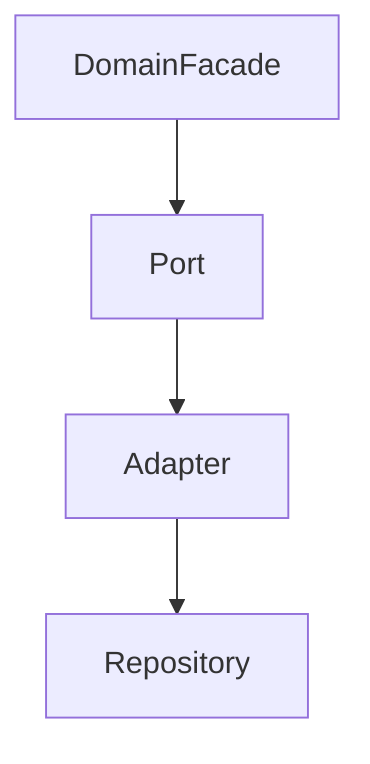

# Repository 설계

> **개요:** Spring Data Repository는 Adapter 아래 기술 접근입니다.
> 도메인 Facade는 Port만 호출합니다.
> 구현 복사는 원셋 repository입니다. **하네스 필수 읽기나 원셋 복사 경로에는 넣지 않습니다.**

목록 기본은 Spec + Pageable입니다.
derived query method는 원셋에서 쓰지 않습니다.
하위 글은 [Repository index](/docs/knowledge/backend/repository/index)를 봅니다.

## Spring Data JPA 공식 목차에서 고른 글 (필독 아님)

공식 사이드바 전부를 옮기지 않습니다.
원셋·실무에 쓸 것만 씁니다. **아직 없는 글은 링크로 걸지 않습니다.**

| 우선 | 주제 (공식 목차명) | 메모 |
|------|-------------------|------|
| 작성됨 | Specifications | [Spec과 Filter](/docs/knowledge/backend/repository/repository-spec-and-filter) — `JpaSpecificationExecutor`, Specs.of, null-safe, derived 금지 |
| 작성됨 | Defining / JPA Query Methods | [Query Methods](/docs/knowledge/backend/repository/repository-query-methods) — 이름 쿼리·`@Query`, 원셋이 derived를 안 쓰는 이유 |
| 작성됨 | Query by Example | [QBE](/docs/knowledge/backend/repository/repository-query-by-example) — Spec·Filter와 비교 |
| 작성됨 | Transactionality | [Transactionality](/docs/knowledge/backend/repository/repository-transactionality) — 리포 기본 TX, Facade·Adapter join 교차 |
| 작성됨 | Locking | [repository-locking](/docs/knowledge/backend/repository/repository-locking) — `LockModeType`, `@Version` vs `@Lock` |
| 작성됨 | Auditing | [Auditing](/docs/knowledge/backend/repository/repository-auditing) — `@CreatedDate` 등, CreatedEntity·UpdatedEntity |
| 이미 있음 | Custom Repository Implementations | [커스텀 리포](/docs/knowledge/backend/repository/repository-custom) |
| 이미 있음 | (페이징) | [Page와 Slice](/docs/knowledge/backend/repository/repository-pagination-and-slice) |
| 선택 | Projections | 인터페이스/클래스 프로젝션. Item DTO와 역할 나눌 때 |
| 선택 | Null Handling of Repository Methods | 짧게 |
| 선택 | Repository query keywords / return types | Query Methods 글 부록으로 충분 |

**이번에 안 씀 (의도적):** Vector Search, Stored Procedures, Value Expressions, Merging persistence units, CDI, Publishing Events from Aggregate Roots, Spring Data Extensions, AOT, FAQ, Glossary, Envers.

---

## 관련

- [엔티티 최소 사용과 CQRS](/docs/knowledge/backend/entity/entity-minimal-and-cqrs)
- [Port와 Adapter 역할](/docs/knowledge/backend/service/service-port-adapter-role)
