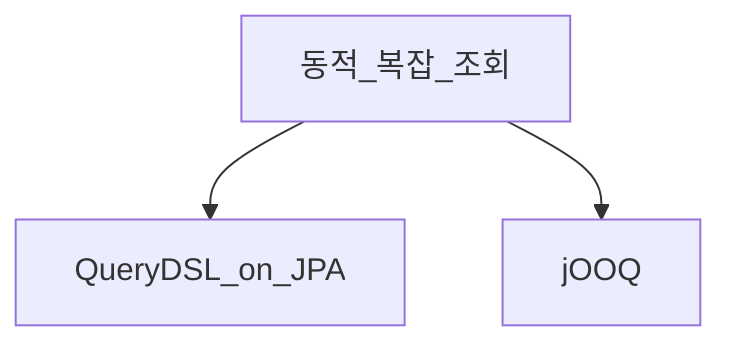

# jOOQ와 SQL 빌더

> **개요:** QueryDSL 동적 쿼리까지 오면 “SQL을 타입 세이프하게 쓰자”는 요구가 jOOQ로 이어지기 쉽습니다.
> 원셋 **기본은 JPA 삼중 + Spec**입니다. jOOQ는 선택·비교이며 하네스 필독이 아닙니다.

| | QueryDSL (JPA) | jOOQ |
|--|----------------|------|
| 중심 | JPA 메타모델 | SQL |
| 영속 컨텍스트 | EntityManager와 맞물림 | JDBC/SQL 중심 |
| 잘 맞는 곳 | 도메인 엔티티 조회 확장 | 리포트·복잡 조인·SQL 명시 |

XML SQL 시절의 “쿼리를 명시”하던 감각은 [모델 발전사](/docs/knowledge/backend/entity/persistence-from-xml-to-orm)와 닿습니다.
엔티티 최소·CQRS 원셋과도 모순되지 않습니다. jOOQ는 풀 ORM 대신 SQL을 드러내는 갈래입니다.

스프링 jdbc 쪽 jOOQ 문서는 아직 초안(draft)이라 여기서는 링크하지 않습니다.

---

## 관련

- [QueryDSL 동적 쿼리](/docs/knowledge/backend/repository/repository-querydsl-dynamic)
- [세 인터페이스 조립](/docs/knowledge/backend/repository/repository-three-interfaces)
