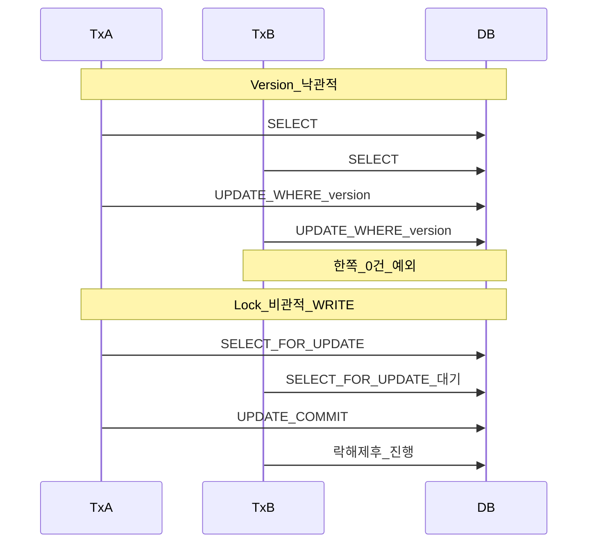
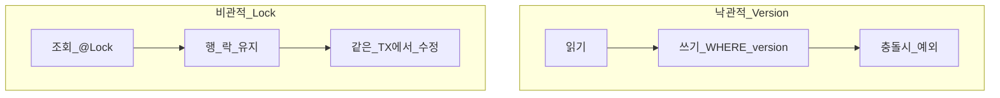
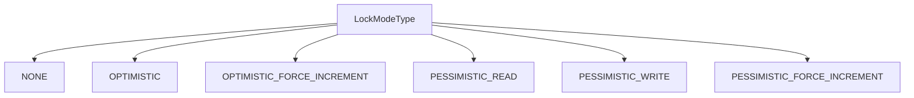

# Repository — Locking

> **개요:** 동시 수정을 다루는 JPA·Spring Data 락입니다.
> 먼저 **`@Version`과 `@Lock`이 뭐가 다른지**를 한 장으로 두고, 이어서 `LockModeType` 옵션과 원셋 자리를 적습니다.
> **하네스 필독 아님.** 구현 복사는 원셋·호스트 관례입니다.

공식 Spring Data JPA 「Locking」·Jakarta locking 튜토리얼과 같은 축을, 이 아카이브 선택으로 다시 씁니다.

---

## 차이 한 장

| | `@Version` | `@Lock(LockModeType…)` |
|--|------------|-------------------------|
| 정체 | 엔티티의 **버전 컬럼** (낙관적 락의 재료) | 조회·lock·refresh·쿼리에 붙이는 **잠금 모드 지시** |
| 언제 힘이 발휘되나 | 주로 **UPDATE / 커밋** 때 `WHERE version=?` 검사 | **그 조회(또는 lock)가 나가는 순간** |
| DB 행 락을 쥐나 | 보통 **안 쥠**. 충돌은 나중에 예외 | **비관적**이면 TX 끝까지 쥠. 낙관적 모드면 버전 쪽 |
| 요청을 나눠 두고 나중에 저장 | **잘 맞음** (폼 열어 둔 동안) | 비관적은 **같은 DB TX 안**에서만 의미 |
| 없이도 되나 | 낙관적 검사가 안 됨 | 비관적만으로도 가능. `OPTIMISTIC*`는 버전 전제 |

한 줄로: **버전은 “쓰고 나서 들켰냐”**, **비관적 `@Lock`은 “읽는 순간부터 남이 못 고치게”** 입니다.
`@Lock`이 항상 비관적인 것은 아닙니다. `LockModeType.OPTIMISTIC*`는 낙관적 계열입니다.



### 타임라인

| 시점 | `@Version`만 | `@Lock(PESSIMISTIC_WRITE)` |
|------|--------------|----------------------------|
| 읽기 | 그냥 SELECT | SELECT + 행 락 |
| 메모리에서 수정 | 자유 (아직 DB 미반영) | 같은 TX 안에서만 안전 |
| flush/커밋 | `UPDATE … WHERE version=?` 후 version++ | UPDATE (락 보유 중) |
| 다른 TX | 그동안 읽고 쓸 수 있음 → 나중에 충돌 가능 | 락 잡힌 행 수정은 대기·실패 |

### SQL 스케치

낙관적(버전 컬럼 있을 때):

```sql
UPDATE example_item SET ..., version = 2
WHERE id = ? AND version = 1;
-- 0건이면 OptimisticLockException 계열
```

비관적 쓰기 락(방언에 따라):

```sql
SELECT ... FROM example_item WHERE id = ? FOR UPDATE;
```

원셋 감사 상위타입 예: [UpdatedEntity](/docs/harness/templates/backend/spring/support/)에 `@Version` 필드가 있습니다.

---

## 두 축 표로 다시

| | `@Version` | `@Lock(LockModeType…)` |
|--|------------|-------------------------|
| 어디에 | 엔티티 필드 | 리포지토리 메서드 (CRUD 재선언 포함) |
| 언제 | UPDATE/커밋 검사 | 조회·lock·refresh·Query.setLockMode |
| 기본 가정 | 충돌은 드묾 | 당장 지키거나(비관), 낙관적 모드를 명시 |
| DB 락 | 보통 없음 | 비관적이면 TX 끝까지 |



원셋·일반 폼 수정은 **`@Version` 낙관적**이 기본 후보입니다.
재고·좌석처럼 같은 행을 짧은 시간에 많이 건드리면 **`PESSIMISTIC_WRITE`** 를 검토합니다.
Advice에서 `ObjectOptimisticLockingFailureException` → 전용 코드는 [HTTP 상태와 엔벨로프](/docs/knowledge/backend/controller/advice-http-status-and-envelope)입니다.

---

## 같이 쓰는 경우

서로 대체재가 아닙니다.

- **비관적 조회 + `@Version`**: 잠가서 읽고 같은 TX에서 저장. 버전은 그대로 증가·검사될 수 있음.
- **`OPTIMISTIC_FORCE_INCREMENT`**: 자식만 바꿔도 부모 버전을 올려 “부모 동시 수정”을 드러낼 때.
- **`@Lock(OPTIMISTIC)`**: 버전 엔티티에 낙관적 읽기 락을 **조회 경로에 명시**. `@Version` 필드가 전제.

잠금 조회와 수정이 **다른 DB TX**로 갈라지면 비관적 보호는 끝입니다.
같은 도메인 Facade 앱 단위·TX 안에 두세요 ([앱 동작 단위](/docs/knowledge/backend/facade/facade-app-unit-and-transactions), [TX join](/docs/knowledge/backend/service/service-tx-join-facade)).

---

## Spring Data에서의 `@Lock`

```java
public interface ExampleItemRepository extends JpaRepository<ExampleItem, Long> {

    @Lock(LockModeType.PESSIMISTIC_WRITE)
    Optional<ExampleItem> findWithWriteLockById(Long id);
}
```

`EntityManager.find` / `lock` / `refresh` / `Query.setLockMode`로도 같은 `LockModeType`을 줄 수 있습니다.

타임아웃은 벤더·힌트(`jakarta.persistence.lock.timeout` 등)에 따릅니다.
데드락을 줄이려면 여러 행을 잠글 때 **id 순**처럼 순서를 고정합니다.

---

## `LockModeType` 옵션

Jakarta Persistence `LockModeType`입니다.
신규 코드는 `READ`/`WRITE` 별칭보다 **OPTIMISTIC_*** / **PESSIMISTIC_*** 이름을 쓰는 편이 낫습니다.

| 값 | 성격 | `@Version` 필요? | 하는 일 (요지) |
|----|------|------------------|----------------|
| `NONE` | 없음 | 아니오 | 추가 락 없음 |
| `OPTIMISTIC` | 낙관적 | **예** (실질) | 버전 엔티티 낙관적 읽기 락. TX 끝 버전 검사에 관여 |
| `OPTIMISTIC_FORCE_INCREMENT` | 낙관적 | **예** | 위 + **버전 강제 증가** |
| `PESSIMISTIC_READ` | 비관적 | 아니오 | 즉시 장기 읽기 락. 수정·삭제 차단. 공유 읽기는 DB 지원 시. 미지원 시 write로 승격 가능 |
| `PESSIMISTIC_WRITE` | 비관적 | 아니오 | 즉시 장기 쓰기(배타) 락 (`FOR UPDATE` 등) |
| `PESSIMISTIC_FORCE_INCREMENT` | 비관적 | 버전 있으면 증가 | 비관적 락 + 버전 증가 |
| `READ` | 별칭 | OPTIMISTIC과 같음 | 신규는 `OPTIMISTIC` |
| `WRITE` | 별칭 | FORCE_INCREMENT와 같음 | 신규는 긴 이름 |



비관적 락을 못 얻으면 `PessimisticLockException` / 타임아웃 계열 → 스프링 `PessimisticLockingFailureException` 등.
낙관적 충돌은 `OptimisticLockException` → `ObjectOptimisticLockingFailureException`.

---

## 원셋·이 아카이브에서의 자리

| 선택 | 메모 |
|------|------|
| 기본 동시성 | 호스트가 `@Version`을 쓰면 낙관적. Advice에 전용 handler |
| 리포 `@Lock` | 핫 패스·짧은 Facade TX 안에서만. 목록 Spec 기본 경로에 남발하지 않음 |
| Facade TX | 잠금 조회와 수정을 **같은** 도메인 Facade 앱 단위·DB TX에 |
| 엔티티 최소 | 그래프·cascade로 락 범위를 키우지 않음 ([minimal-CQRS](/docs/knowledge/backend/entity/entity-minimal-and-cqrs)) |

---

## 관련

- [Repository 설계](/docs/knowledge/backend/repository/repository-design) (허브·목차 표)
- [HTTP 상태와 엔벨로프](/docs/knowledge/backend/controller/advice-http-status-and-envelope) (낙관적 락 응답)
- [Facade — 앱 동작 단위](/docs/knowledge/backend/facade/facade-app-unit-and-transactions)
- [Service — Facade DB TX에 join](/docs/knowledge/backend/service/service-tx-join-facade)
