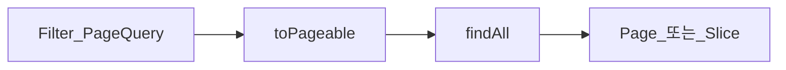

# Page와 Slice

> **개요:** 목록 API의 페이징 반환 타입입니다.
> 원셋은 `Filter`(PageQuery) → `toPageable()` → Spec `findAll(spec, pageable)` 입니다.

| | Page | Slice |
|--|------|-------|
| count 쿼리 | 있음 (total) | 없음 |
| 다음 페이지 | total 기반 | `hasNext` (size+1 관례) |
| 비용 | count가 무거울 수 있음 | 가벼운 스크롤에 유리 |

원셋 목록은 **Page** 쪽이 기본에 가깝습니다 (총건수 UI).
무한 스크롤·count 부담이 크면 Slice를 검토합니다.
`Pageable.unpaged()`는 Name 맵 등 소량 전량에만.

DEFAULT_SIZE 20, MAX_SIZE 100은 [PageQuery / support](/docs/harness/templates/backend/spring/support/)입니다.

---

## 관련

- [Spec과 Filter](/docs/knowledge/backend/repository/repository-spec-and-filter)
