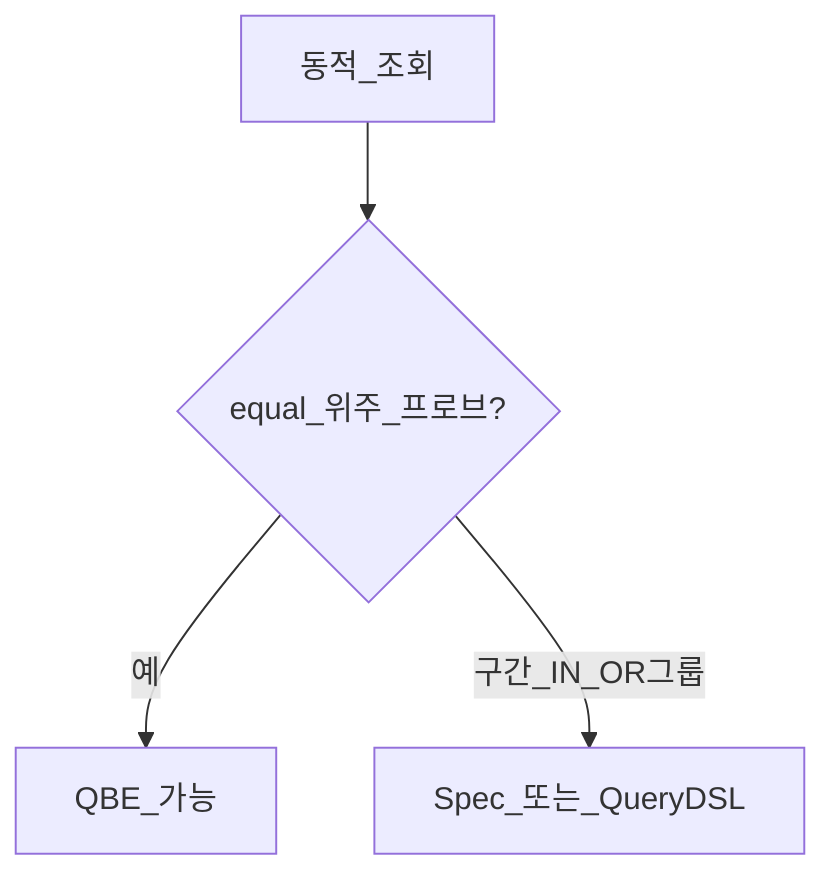

# Repository — Query by Example

> **개요:** Query by Example(QBE)은 **예시 엔티티(probe)** 로 조회 조건을 만드는 Spring Data API입니다.
> Spec·Filter와 겹치는 지점과 **한계**를 적고, 원셋 기본이 Spec인 이유를 밝힙니다.
> **하네스 필독 아님.**

공식 「Query by Example」 축을 이 아카이브 선택으로 다시 씁니다.

---

## 구성

| 조각 | 역할 |
|------|------|
| Probe | 값이 채워진 도메인 객체 (예시) |
| `ExampleMatcher` | 문자열 매칭(exact/contain…), null 취급, 무시 경로 |
| `Example` | probe + matcher |
| `QueryByExampleExecutor` | `findAll(Example)`, fluent `findBy(Example, …)` |

```java
ExampleItem probe = new ExampleItem();
probe.setUrl("/api/x"); // 개념 스케치 — 실제 엔티티 세터 관례는 호스트를 따름
ExampleMatcher matcher = ExampleMatcher.matching()
    .withIgnoreNullValues()
    .withMatcher("url", ExampleMatcher.GenericPropertyMatchers.exact());
Example<ExampleItem> example = Example.of(probe, matcher);
repository.findAll(example, pageable);
```

`JpaRepository`는 보통 `QueryByExampleExecutor`를 이미 포함합니다.

---

## 잘 맞는 경우 / 한계

**잘 맞는 경우**

- 필드 exact(또는 단순 문자열) 조건이 대부분일 때
- 프로브만 채워 동적 조회를 빠르게 실험할 때
- 도메인 필드 rename에 이름 기반 derived보다 덜 깨질 때(프로브 필드 기준)

**한계 (공식과 동일 계열)**

- 중첩·그룹 조건: `A = ? OR (B = ? AND C = ?)` 같은 조합이 약함
- 컬렉션·맵 매칭 없음
- 문자열 외 타입은 대체로 exact
- `ids IN (…)`, 날짜 구간(`startAt`/`endAt`) 같은 **목록 API 단골**은 Spec이 낫다



---

## Spec·Filter와 비교

| | QBE | 원셋 Spec + Filter |
|--|-----|---------------------|
| 조건 입력 | 엔티티 probe | API Filter DTO |
| null | matcher ignore | PredicateBuilder skip |
| IN / 구간 | 약함·우회 | `in`, goe/loe 기본 관례 |
| API 경계 | 엔티티가 새어 나가기 쉬움 | Filter가 요청 모델 |
| 원셋 기본 | 쓰지 않음 | **목록 기본** |

Facade·Controller는 엔티티가 아니라 DTO를 봅니다.
Filter → Spec이 계층과 맞습니다.
QBE를 쓰면 Adapter 안에서 probe를 조립하더라도, Filter와 이중 모델을 유지하게 됩니다.

---

## 이 아카이브 선택

- **목록·검색:** [Spec과 Filter](/docs/knowledge/backend/repository/repository-spec-and-filter)
- **QBE:** 학습·특수 단순 조회 참고. 원셋 ExampleItem 경로의 기본이 아님
- 더 복잡한 동적 where: [QueryDSL](/docs/knowledge/backend/repository/repository-querydsl-dynamic)

---

## 관련

- [Spec과 Filter](/docs/knowledge/backend/repository/repository-spec-and-filter)
- [Query Methods](/docs/knowledge/backend/repository/repository-query-methods)
- [Repository 설계](/docs/knowledge/backend/repository/repository-design)
