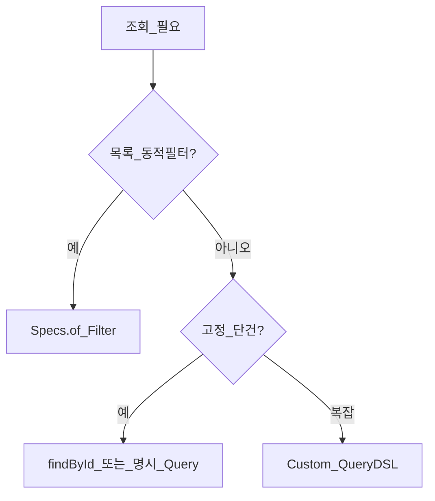

# Repository — Query Methods

> **개요:** Spring Data의 **쿼리 메서드**는 리포지토리 메서드 선언으로 조회·수정을 정의하는 방식입니다.
> 이름 파생(derived)과 `@Query`를 구분하고, **원셋이 목록에서 derived를 금지하는 이유**를 밝힙니다.
> **하네스 필독 아님.**

공식 「Defining Query Methods」 / 「JPA Query Methods」 축을 이 아카이브 선택으로 다시 씁니다.

---

## 무엇이 Query Method인가

인터페이스에 메서드를 선언하면 Spring Data가 구현을 만듭니다.

| 종류 | 예 | 쿼리 출처 |
|------|-----|-----------|
| Derived | `findByUrl(String url)` | 메서드 이름 파싱 |
| 선언형 `@Query` | `@Query("select e from …")` | JPQL/네이티브 문자열 |
| 상속 CRUD | `findById`, `save` | `SimpleJpaRepository` |
| Spec 실행 | `findAll(Specification, Pageable)` | Criteria (Executor) |

이름 키워드 예: `And`, `Or`, `Between`, `LessThan`, `Containing`, `OrderBy…`.
반환 타입은 엔티티, `Optional`, `List`, `Page`, `Slice`, `Stream` 등입니다.

```java
// 공식 문서에서 흔히 보는 derived — 원셋 목록 경로에서는 쓰지 않음
List<ExampleItem> findByUrlAndHttpMethod(String url, String httpMethod);
```

```java
@Query("select e from ExampleItem e where e.url = :url")
Optional<ExampleItem> findOneByUrl(@Param("url") String url);
```

---

## 원셋 선택: 목록은 Spec



| 경로 | 원셋 |
|------|------|
| 목록·검색 | `JpaSpecificationExecutor` + `Specs.of(Filter)` |
| 단건 PK | `findById` |
| 복잡·동적 SQL성 | Custom + QueryDSL 자리 |
| `findByUrl…` derived | **목록에 도입하지 않음** |

이유:

1. **조건이 Filter에 모인다.** 컨트롤러·Facade·Adapter·Spec이 같은 필드를 본다.
2. **메서드 폭발 방지.** `findByAAndBAndC…`는 조합마다 시그니처가 는다.
3. **null 조건.** derived는 “이 파라미터 무시”를 이름만으로 표현하기 어렵다. Spec + PredicateBuilder가 null-safe에 맞다.
4. **한 곳 수정.** 컬럼·조건 추가 시 Spec `of`만 고치면 된다.

단건·배치처럼 **항상 같은 고정 조건**이면 `@Query` 한 메서드는 허용 범위로 볼 수 있습니다.
그때도 목록 Filter와 조건을 복제하지 마세요.

---

## `@Query`와 modifying

`@Modifying` + `@Query`로 bulk update/delete를 할 수 있습니다.
영속성 컨텍스트와 어긋날 수 있어 `clearAutomatically` 등을 검토합니다.
원셋 소프트 삭제 기본은 엔티티 메서드 + Spec 조회 후 순회인 경우가 많습니다.
벌크는 의도적으로 쓸 때만.

트랜잭션 속성은 [Transactionality](/docs/knowledge/backend/repository/repository-transactionality)입니다.
선언한 쿼리 메서드는 CRUD 상속과 달리 **기본적으로 TX가 안 붙을 수 있습니다.**

---

## 키워드·반환 타입 (부록 요지)

| 주제 | 요지 |
|------|------|
| `Exists` / `Count` | `existsBy…`, `countBy…` |
| 정렬 | 이름 `OrderBy` 또는 `Sort` / `Pageable` 인자 |
| 삭제 derived | `deleteBy…` — 대량·감사와 충돌하기 쉬움. 신중 |
| 프로젝션 | 인터페이스/클래스 프로젝션은 이번 Knowledge 범위 밖(선택 주제) |

이름 전체 키워드 표는 공식 reference를 보고, 여기에는 **원셋이 피하는 이유**를 남깁니다.

---

## 함정

- derived와 Spec에 **같은 필터**를 반반 두면 버그 온상입니다.
- 메서드 이름 오타·잘못된 프로퍼티는 **기동 시** 실패하는 경우가 많습니다. 빠른 피드백이지만 리팩터 비용이 큽니다.
- `List`로 대량을 받으면 메모리·타임아웃. 페이징은 [Page와 Slice](/docs/knowledge/backend/repository/repository-pagination-and-slice).

---

## 관련

- [Spec과 Filter](/docs/knowledge/backend/repository/repository-spec-and-filter)
- [세 인터페이스 조립](/docs/knowledge/backend/repository/repository-three-interfaces)
- [Transactionality](/docs/knowledge/backend/repository/repository-transactionality)
