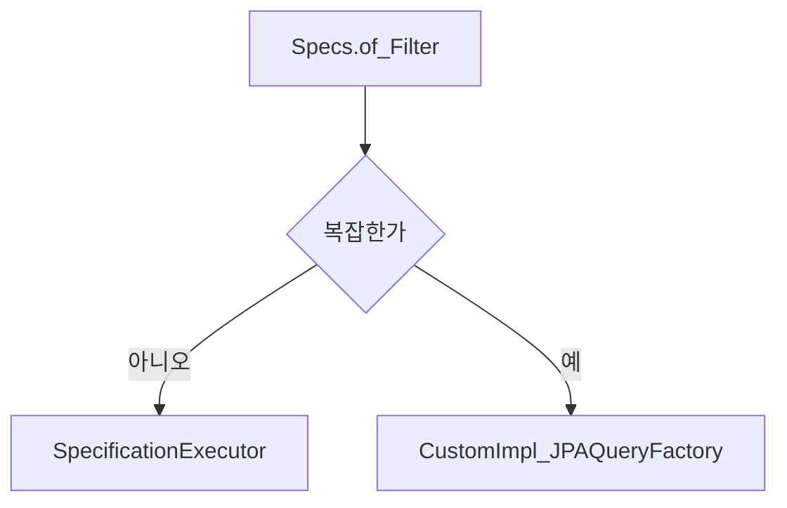

# QueryDSL Custom 자리

> **개요:** Spec으로 표현이 빡세지면 Custom Impl + `JPAQueryFactory`로 갑니다.
> 원셋은 Impl에 queryFactory 필드 골격만 있어도 “자리가 있다”는 신호입니다.

동적 where 조립은 [QueryDSL 동적 쿼리](/docs/knowledge/backend/repository/repository-querydsl-dynamic)입니다.
SQL 중심 빌더 대안은 [jOOQ](/docs/knowledge/backend/repository/repository-jooq-and-sql-builders)입니다.

---

## 관련

- [커스텀 리포](/docs/knowledge/backend/repository/repository-custom)
