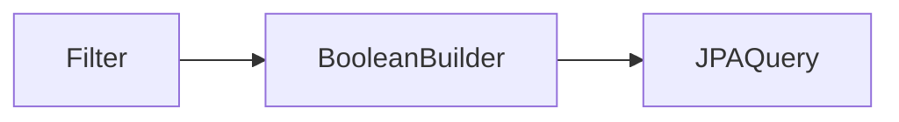

# QueryDSL 동적 쿼리

> **개요:** 타입 세이프 빌더로 조건을 조합합니다.
> Spec `of(Filter)`와 같은 “동적 필터”를 QueryDSL로 옮길 때의 패턴입니다.
> 기존 메모 [DynamicQuery](/docs/knowledge/k-dynamicquery)는 참고 링크, 원셋 관점은 이 글입니다.

요지:

- null/blank 필드는 술어에 넣지 않음
- `BooleanBuilder`에 `and`/`or`로 조합
- 정렬·페이징은 QueryDSL API 또는 Pageable과 맞춤
- 빈 술어만 남지 않게 가드

원셋 목록 기본은 여전히 Spec입니다.
QueryDSL은 Custom 경로의 확장입니다.

jOOQ와의 갈림길: [jOOQ와 SQL 빌더](/docs/knowledge/backend/repository/repository-jooq-and-sql-builders).

---

## 관련

- [QueryDSL Custom 자리](/docs/knowledge/backend/repository/repository-querydsl-custom)
