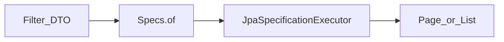

# Spec과 Filter

> **개요:** 목록 조건은 `ExampleItemSpecs.of(Filter)` 한 공장으로 모읍니다.
> Spring Data `Specification` / `JpaSpecificationExecutor`를 원셋 Filter와 어떻게 붙이는지 깊게 적습니다.
> **하네스 필독 아님.** 구현 복사는 원셋 Spec·Adapter입니다.

공식 Spring Data JPA 「Specifications」 축을, 이 아카이브 선택으로 다시 씁니다.

---

## 왜 Spec인가

derived query method(`findByUrlAndHttpMethod…`)는 조건이 늘 때마다 메서드가 늘거나 이름이 깨집니다.
조건 조합은 **런타임 Predicate**가 맞습니다.

Spring Data JPA는 `JpaSpecificationExecutor`로 `findAll(Specification, Pageable)`을 줍니다.
원셋은 여기에 **요청 Filter DTO**를 한 곳에서 `Specification`으로 바꿉니다.



| 축 | 역할 |
|----|------|
| `ExampleItemReq.Filter` | API·Facade가 넘기는 검색 조건 (`PageQuery` 상속 가능) |
| `ExampleItemSpecs.of` | Filter → `Specification` |
| Repository | `JpaRepository` + `JpaSpecificationExecutor` + Custom |
| Adapter | `findAll(Specs.of(filter), pageable)` 호출, 엔티티→응답 DTO |

세 인터페이스 조립은 [세 인터페이스](/docs/knowledge/backend/repository/repository-three-interfaces)입니다.

---

## `Specification`이 하는 일

`Specification<T>`는 `(root, query, criteriaBuilder) → Predicate` 입니다.
Criteria API로 where를 조립합니다.

여러 Spec을 이어 붙일 때는 `Specification.where(a).and(b).or(c)` 패턴을 씁니다.
원셋은 **한 메서드 `of(Filter)` 안에서** null이 아닌 필드만 Predicate에 넣는 쪽이 기본입니다.
조건마다 별도 public Spec 메서드를 잔뜩 두지 않습니다. 재사용이 분명할 때만 조각냅니다.

```java
public static Specification<ExampleItem> of(ExampleItemReq.Filter filter) {
    return (root, query, builder) -> {
        PredicateBuilder predicateBuilder = new PredicateBuilder(builder, root);
        predicateBuilder.equal(ExampleItem.Fields.url, filter.getUrl());
        predicateBuilder.in(ExampleItem.Fields.id, filter.getIds());
        // …
        return predicateBuilder.build();
    };
}
```

`PredicateBuilder`는 원셋 support의 null-safe 헬퍼입니다.
값이 null이면 해당 equal/in을 건너뜁니다.
그래서 “필터 필드가 비어 있으면 전체(또는 다른 조건만)”가 자연스럽습니다.

---

## 원셋 Filter 관례

| Filter 필드 | Spec 쪽 | 메모 |
|-------------|---------|------|
| 단일 equal 컬럼 | `equal(필드, 값)` | id, url, httpMethod 등 |
| `ids` | `in(id, ids)` | 배치·삭제 후보 |
| `startAt` / `endAt` | `createdAt` goe/loe | `CreatedEntity` 필드 |
| 페이징 | Spec이 아님 | `Pageable` / `PageQuery` |

**`ids`가 null이거나 empty면 조회하지 않고 빈 결과를 반환**하는 관례가 Adapter에 있습니다.
대량 IN을 실수로 전체 스캔처럼 돌리지 않기 위함입니다. (삭제·배치 경로)

coding-conventions Persistence와 같습니다.
**derived query method는 쓰지 않습니다.** 조건이 Spec 밖으로 새면 목록 경로가 둘로 갈라집니다.

---

## and / or / 조인

단순 목록은 `of` 안 equal들의 AND로 충분합니다.
OR 그룹이나 연관 조인이 필요하면:

1. 같은 `of` 안에서 Criteria로 그룹 Predicate를 만들거나
2. Custom + QueryDSL로 옮깁니다 → [QueryDSL 동적 쿼리](/docs/knowledge/backend/repository/repository-querydsl-dynamic)

`query.distinct(true)`는 조인으로 행이 늘어날 때 검토합니다.
페이지 total과 distinct를 섞으면 카운트 쿼리 함정이 있으니, 조인 Spec은 신중히 둡니다.

---

## Spec vs QBE vs QueryDSL

| 수단 | 잘 맞는 때 | 원셋 기본 |
|------|------------|-----------|
| Spec + Filter | 동적 equal/in/구간, 목록 API | **예** |
| Query by Example | 프로브 엔티티 exact/문자열 매칭이 단순할 때 | 아니오 → [QBE](/docs/knowledge/backend/repository/repository-query-by-example) |
| QueryDSL Custom | 복잡한 동적 where, 프로젝션 | 자리만 → [Custom](/docs/knowledge/backend/repository/repository-querydsl-custom) |
| derived / `@Query` 이름 | 고정 단건·소수 조건 | 목록에 쓰지 않음 → [Query Methods](/docs/knowledge/backend/repository/repository-query-methods) |

---

## 페이징

`findAll(spec, pageable)` → `Page`.
총건수가 비싸면 Slice 전략을 봅니다 → [Page와 Slice](/docs/knowledge/backend/repository/repository-pagination-and-slice).

`Pageable.unpaged()`는 “필터만 적용한 전체 목록”에 Adapter가 쓰는 경우가 있습니다.
대량 테이블에서는 상한·스트리밍을 따로 생각합니다.

---

## 함정

- Spec과 derived를 **같은 필터**에 섞으면 조건이 어긋납니다. 목록은 Spec만.
- Filter에 새 필드를 추가하고 Spec `of`를 안 고치면 **조용히 무시**됩니다.
- 연관 fetch를 Spec 조인에 욱여넣으면 페이징이 깨질 수 있습니다. 그래프는 [엔티티 최소·CQRS](/docs/knowledge/backend/entity/entity-minimal-and-cqrs) 쪽.
- 락이 필요하면 Spec 목록이 아니라 단건 `@Lock` 조회를 짧은 TX에 둡니다 → [Locking](/docs/knowledge/backend/repository/repository-locking).

---

## 관련

- [세 인터페이스 조립](/docs/knowledge/backend/repository/repository-three-interfaces)
- [Query Methods](/docs/knowledge/backend/repository/repository-query-methods)
- [Query by Example](/docs/knowledge/backend/repository/repository-query-by-example)
- [support / PageQuery](/docs/harness/templates/backend/spring/support/)
