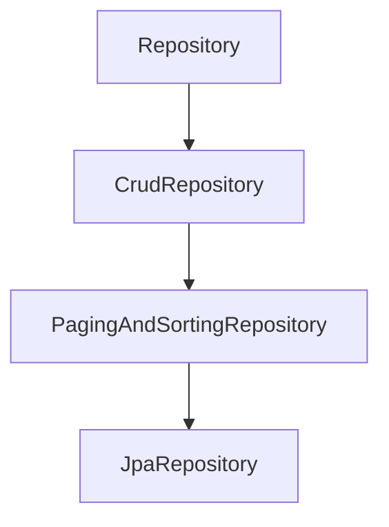

# Spring Data Repository 계층

> **개요:** 스프링 데이터가 주는 인터페이스 계단입니다.
> 원셋은 `JpaRepository`를 고릅니다.

| 인터페이스 | 여는 것 |
|------------|---------|
| `Repository` | 마커·쿼리 메서드 기반 |
| `CrudRepository` | save, findById, delete, … |
| `PagingAndSortingRepository` | Pageable·Sort |
| `JpaRepository` | JPA flush, batch, `List` 반환 등 |

원셋 ExampleItem은 `JpaRepository` + Spec + Custom을 함께 붙입니다 → [세 인터페이스](/docs/knowledge/backend/repository/repository-three-interfaces).

---

## 관련

- [커스텀 리포](/docs/knowledge/backend/repository/repository-custom)
