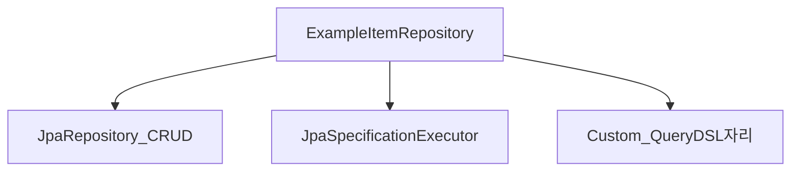

# Repository 세 인터페이스 조립

> **개요:** 원셋 `ExampleItemRepository`는 세 축을 동시에 extends 합니다.

```text
JpaRepository + JpaSpecificationExecutor + CustomRepository
```



| 축 | 역할 | 원셋 기본 경로 |
|----|------|----------------|
| JpaRepository | findById, save, … | 단건·저장 |
| JpaSpecificationExecutor | `findAll(Spec, Pageable)` | **목록·필터** |
| Custom | QueryDSL 등 | 복잡 조회 자리 |

derived query method(`findByUrl…`)는 쓰지 않습니다.
필터는 `Specs.of(Filter)` → [Spec과 Filter](/docs/knowledge/backend/repository/repository-spec-and-filter).

계층·Custom 단독 설명: [Spring Data 계층](/docs/knowledge/backend/repository/repository-spring-data-hierarchy), [커스텀 리포](/docs/knowledge/backend/repository/repository-custom).

---

## 관련

- [엔티티 최소 사용과 CQRS](/docs/knowledge/backend/entity/entity-minimal-and-cqrs)
