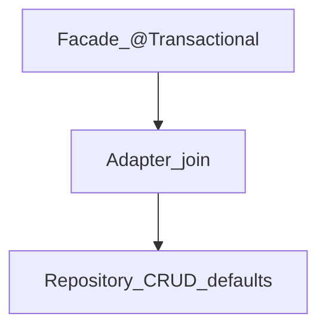

# Repository — Transactionality

> **개요:** Spring Data JPA 리포지토리 메서드에 **어떤 `@Transactional`이 기본으로 붙는지**를 정리합니다.
> 앱 동작 단위와 Adapter join은 Facade·Service Knowledge에 두고, 여기서는 **리포 계층 기본값**에 집중합니다.
> **하네스 필독 아님.**

공식 「Transactionality」 축을 이 아카이브 선택으로 다시 씁니다.

---

## 상속 CRUD의 기본

`SimpleJpaRepository` 구현을 상속하는 CRUD는 대략 이렇게 동작합니다.

| 종류 | 기본 TX 요지 |
|------|----------------|
| 읽기 (`find…`, `exists…` 등) | `@Transactional(readOnly = true)` |
| 쓰기 (`save`, `delete` 등) | `@Transactional` (읽기 전용 아님) |

리포지토리 **프래그먼트(Custom Impl)** 메서드에 TX가 있으면 그 설정을 따릅니다.

---

## 직접 선언한 쿼리 메서드

인터페이스에 새로 적은 derived / `@Query` / default 메서드는 **자동으로 CRUD와 같은 TX가 붙지 않습니다.**
트랜잭션 안에서 돌리려면 인터페이스나 메서드에 `@Transactional`을 명시합니다.

```java
@Transactional(readOnly = true)
public interface ExampleItemRepository extends JpaRepository<ExampleItem, Long> {

    @Query("…")
    List<ExampleItem> findFixedSomething(…);

    @Modifying
    @Transactional  // 쓰기 — readOnly 해제
    @Query("delete from …")
    void bulkDeactivate(…);
}
```

`readOnly = true`는 “쓰기 금지 검사”가 아니라 **힌트**에 가깝습니다.
JDBC·Hibernate 쪽 최적화(예: flush mode)에 쓰입니다.
조작 쿼리를 readOnly TX에서 돌리면 DB/드라이버에 따라 거절되거나 예기치 않은 동작이 납니다.

---

## 원셋: 경계를 Facade에 둔다

공식도 **작업 단위를 시작하는 곳**에 TX를 두는 편을 권합니다.
원셋·coding-conventions:

- **도메인 Facade**가 앱 동작 단위이자 DB TX를 연다
- **JPA Adapter**는 같은 TX에 **join** (`readOnly` 기본, 쓰기는 메서드 오버라이드)
- **Controller에서 TX 시작 금지**
- Repository에 비즈니스 TX 경계를 새로 쌓지 않음



리포 기본 TX는 **Facade 밖에서 리포만 단독 호출할 때** 안전망에 가깝습니다.
정상 경로에서는 Facade TX 안에서 리포가 참여합니다.

서사 분리:

- 앱 TX ≠ DB TX, BFF vs 도메인 → [Facade 앱 동작 단위](/docs/knowledge/backend/facade/facade-app-unit-and-transactions)
- Adapter join 규칙 → [Service TX join](/docs/knowledge/backend/service/service-tx-join-facade)
- 잠금 조회와 수정은 **같은** DB TX → [Locking](/docs/knowledge/backend/repository/repository-locking)

---

## 함정

- Custom/`@Query`만 추가하고 TX·Facade 호출을 잊으면 **TX 없이** 실행될 수 있습니다.
- 리포에 `REQUIRES_NEW`를 남발하면 Facade 단위가 깨집니다.
- `readOnly` Facade 안에서 쓰기 리포를 호출하면 참여 규칙·예외에 주의합니다. 쓰기는 Facade/Adapter 쓰기 TX 경로로.

---

## 관련

- [Facade — 앱 동작 단위](/docs/knowledge/backend/facade/facade-app-unit-and-transactions)
- [Service — Facade DB TX에 join](/docs/knowledge/backend/service/service-tx-join-facade)
- [Query Methods](/docs/knowledge/backend/repository/repository-query-methods)
