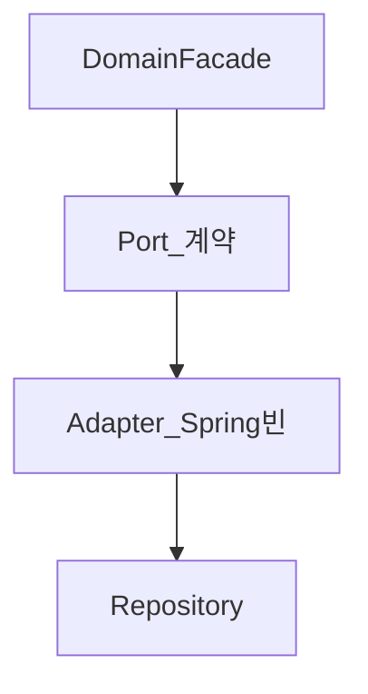

# 데이터 접근 경계 (Port와 Adapter)

> **개요:** 메뉴·slug의 Service는 하위 호환입니다.
> 유스케이스는 Facade입니다. 이 층은 **Spring 서비스 빈**이면서 **Port의 Adapter 구현**입니다.
> 구현 복사·검증은 원셋 persistence와 coding-conventions입니다 ([ADR-0010](/docs/decisions/adr-0010)).
> **하네스 필수 읽기나 원셋 복사 경로에는 넣지 않습니다.** 깊이 필요할 때만 읽습니다.

## 이중 정체성

| 면 | 의미 |
|----|------|
| Spring | `@Service`/`@Component` 스캔, 생성자 주입, `@Transactional` 프록시 |
| 헥사 | Port를 구현하는 Adapter. 레거시 `*Service`의 JPA 감싸기 역할 |

업무 규칙·시나리오 조립은 [Facade](/docs/knowledge/backend/facade/facade-design)로 올립니다.
DB 제약·영속을 애플리케이션으로 옮기라는 뜻이 아닙니다.

`docs/knowledge/backend/spring/**` 초안은 스프링 **백과** 자리입니다.
원셋에 맞춘 실무 블로그는 아래 섹터에 둡니다.

## 하위 글

### 역할 (S0)

| 글 | 내용 |
|----|------|
| [Port와 Adapter 역할](/docs/knowledge/backend/service/service-port-adapter-role) | 계약·구현·레거시 이름 |
| [Provider와 CQRS](/docs/knowledge/backend/service/service-provider-and-cqrs) | 교체 가능한 Provider, CQRS 적용점 |

### 주입 발전사 (S1)

| 글 | 내용 |
|----|------|
| [스테레오타입과 스캔](/docs/knowledge/backend/service/service-stereotype-scan) | `@Service` 등 |
| [DI 발전사](/docs/knowledge/backend/service/service-di-evolution) | XML → Autowired → 생성자 → RequiredArgsConstructor |
| [XML·매퍼 주입](/docs/knowledge/backend/service/service-di-xml-and-mapper) | 옛 mapper·Repo 주입 |
| [생성자 주입이 기본인 이유](/docs/knowledge/backend/service/service-di-constructor-preferred) | final·테스트 |
| [어디에 무엇을 주입하나](/docs/knowledge/backend/service/service-di-injection-points) | Facade는 Port만 |

### 트랜잭션 (S2)

| 글 | 내용 |
|----|------|
| [Facade DB TX에 join](/docs/knowledge/backend/service/service-tx-join-facade) | Adapter `@Transactional` |

앱 동작 단위 정의는 [Facade — 앱 동작 단위](/docs/knowledge/backend/facade/facade-app-unit-and-transactions)입니다.

## 관련

- [애플리케이션 영역과 Facade](/docs/knowledge/backend/facade/facade-design)
- [CQRS](/docs/patterns/architecture-patterns/cqrs)
- 원셋: `docs/harness/templates/backend/spring/exampleitem/persistence/`
