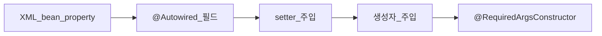

# Service — DI 발전사

> **개요:** Spring에서 의존성을 넣는 방식이 어떻게 바뀌어 왔는지, 원셋 Adapter·Facade에 무엇이 남았는지를 적습니다.
> 허브는 [데이터 접근 경계](/docs/knowledge/backend/service/service-design)입니다.

Spring Boot도 생성자 주입과 컴포넌트 스캔을 권장합니다.
필드 `@Autowired`만으로 필수 의존을 채우던 시절의 습관과 구분합니다.

---

## 타임라인

| 시기·방식 | 하는 일 | 남는 문제 |
|-----------|---------|-----------|
| XML `<bean>` + property / constructor-arg | 설정 파일에 조립 | XML·클래스 이중 관리 |
| `@Autowired` 필드 | 애너테이션으로 주입 | final 불가, 테스트·반사, 숨은 의존 |
| setter `@Autowired` | 선택 의존에 적합 | 필수 의존에 쓰면 null 검사 부담 |
| 생성자 주입 | 필수 의존을 생성 시 확정 | 인자가 많으면 책임 과다 냄새 |
| `@RequiredArgsConstructor` + `final` | 생성자 보일러플레이트 감소 | Lombok·`@Value` 필드와 규칙 맞출 것 |

단일 생성자만 있으면 Spring 4.3+에서 생성자에 `@Autowired`를 생략해도 됩니다.
생성자가 여러 개면 쓸 쪽에 `@Autowired`를 명시합니다.

---

## 원셋에 남은 것

Facade·Adapter는 **`final` 필드 + `@RequiredArgsConstructor`**(또는 동등 생성자)가 기본입니다.
필드 `@Autowired`를 신규에 쓰지 않습니다.

선택 의존은 setter나 `ObjectProvider`·`@Autowired(required = false)`를 검토합니다.
필수는 생성자로 둡니다.

XML로 Repository를 Service에 넣던 기억은 [XML·매퍼 주입](/docs/knowledge/backend/service/service-di-xml-and-mapper)에 둡니다.
왜 생성자가 기본인지는 [생성자 주입이 기본인 이유](/docs/knowledge/backend/service/service-di-constructor-preferred)에 둡니다.

---

## 관련

- [스테레오타입과 스캔](/docs/knowledge/backend/service/service-stereotype-scan)
- [생성자 주입이 기본인 이유](/docs/knowledge/backend/service/service-di-constructor-preferred)
- [어디에 무엇을 주입하나](/docs/knowledge/backend/service/service-di-injection-points)
