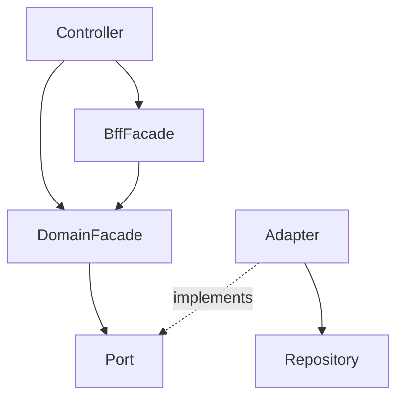

# Service — 어디에 무엇을 주입하나

> **개요:** 계층마다 주입해도 되는 대상이 다릅니다.
> 허브는 [데이터 접근 경계](/docs/knowledge/backend/service/service-design)입니다.

---

## 표

| 빈 | 주입하는 것 | 주입하지 않는 것 |
|----|-------------|------------------|
| DomainFacade | 자기 도메인 Port, DisplayNameResolver | Repository, entity, Spec, 다른 도메인 Adapter |
| BffFacade | 도메인 Facade(들) | DomainPort, Repository |
| JPA Adapter | Repository, (필요 시) Provider | Facade, 와이어 DTO |
| Controller | Facade (또는 BffFacade) | Port, Repository |

`final` + `@RequiredArgsConstructor`로 필수 의존만 생성자에 올립니다.
Facade가 Repository를 직접 받으면 Port 경계와 테스트 대체가 무너집니다.

---

## 관련

- [Port와 Adapter 역할](/docs/knowledge/backend/service/service-port-adapter-role)
- [생성자 주입이 기본인 이유](/docs/knowledge/backend/service/service-di-constructor-preferred)
- [Facade — 진입과 이름](/docs/knowledge/backend/facade/facade-entry-and-naming)
