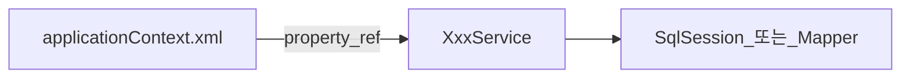
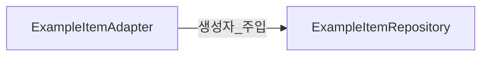

# Service — XML·매퍼 주입

> **개요:** 설정 XML과 SQL 매퍼를 Service에 주입하던 기억을, 지금 JPA Repository·Port 주입과 대응시킵니다.
> 허브는 [데이터 접근 경계](/docs/knowledge/backend/service/service-design)입니다.
> 데이터 **모델**이 Map→VO→DTO→Entity로 바뀐 이야기는 Entity/Repository Knowledge(모델 발전사)에 둡니다. 이 글은 **빈에 어떻게 넣었는가**입니다.

---

## 예전에 흔했던 모양

- `<bean id="fooService">` + `<property name="fooMapper" ref="..."/>`
- MyBatis 매퍼 인터페이스를 스캔해 Service 필드에 `@Autowired`
- JDBC Template·SqlMapClient를 직접 Service가 보유

클래스를 열기 전에 XML을 찾아다녀야 했고, 리팩터 시 설정과 코드가 어긋나기 쉬웠습니다.

---

## 지금 원셋

- Adapter가 `ExampleItemRepository`(Spring Data)를 **생성자**로 받습니다
- SQL/XML 매퍼 파일을 Service가 직접 쥐지 않습니다
- 복잡한 SQL이 필요하면 Custom + QueryDSL(또는 이후 jOOQ 비교) 자리로 갑니다 — Repository Knowledge

어노테이션 설정·Java `@Configuration`으로 넘어온 뒤에도, **필수 의존은 생성자**라는 점은 [생성자 주입](/docs/knowledge/backend/service/service-di-constructor-preferred)과 같습니다.

---

## 관련

- [DI 발전사](/docs/knowledge/backend/service/service-di-evolution)
- [Port와 Adapter 역할](/docs/knowledge/backend/service/service-port-adapter-role)
