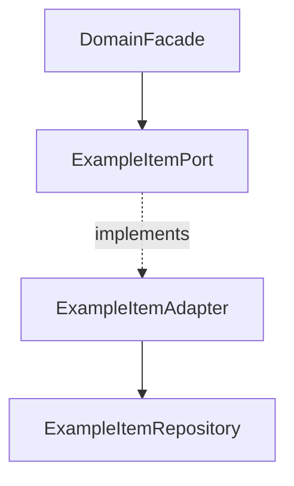

# Service — Port와 Adapter 역할

> **개요:** 유스케이스는 Facade입니다. 이 글은 영속·외부 능력의 **계약과 구현**만 다룹니다.
> 허브는 [데이터 접근 경계](/docs/knowledge/backend/service/service-design)입니다.

---

## 책임

| 구성 | 책임 |
|------|------|
| Port | 저장·조회·외부 능력의 계약. 애플리케이션(도메인 Facade)이 의존하는 인터페이스 |
| Adapter | Port 구현. Repository·HTTP 클라이언트·Provider 호출, 엔티티↔Port DTO 변환 |
| Facade | 업무 허용·순서·조합 — [Facade](/docs/knowledge/backend/facade/facade-design) |

Adapter에 남기는 것:

- 존재 여부·없을 때 오류
- 그 데이터의 상태 전이·삭제 의미
- 집합 안 저장 제약
- 엔티티 ↔ Port DTO 변환

Facade가 조율하는 것:

- Port 호출 순서
- 화면·BFF용 조합
- 부분 실패 정책
- 로컬 TX에 넣을 변경 범위 ([앱 동작 단위](/docs/knowledge/backend/facade/facade-app-unit-and-transactions))

---

## 레거시 `*Service`

기존 코드의 `*Service`는 대부분 **JPA를 감싼 Adapter 역할**입니다.
새 템플릿은 `ExampleItemPort` / `ExampleItemAdapter`처럼 역할이 이름에 드러나게 둡니다.
이미 `Service`인 저장소를 일괄 개명할 의무는 없습니다.
역할을 Adapter로 이해하고, 신규·리팩터 시 Port와 Adapter로 맞춥니다.

RestClient 구현체도 같습니다.
계약이 Port이고 HTTP 호출이 Adapter입니다.

---

## 누가 Port를 보나

- 도메인 Facade만 자기 도메인 Port를 호출합니다
- BFF는 도메인 진입만 보고 DomainPort를 주입하지 않습니다
- Adapter는 Facade를 참조하지 않습니다 (순환 금지)

BFF 전용 Port를 만들지 않습니다.

---

## 관련

- [데이터 접근 경계](/docs/knowledge/backend/service/service-design) (허브)
- [Provider와 CQRS](/docs/knowledge/backend/service/service-provider-and-cqrs)
- [ADR-0010](/docs/decisions/adr-0010)
- 원셋 persistence: `docs/harness/templates/backend/spring/exampleitem/persistence/`
