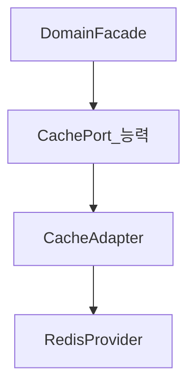
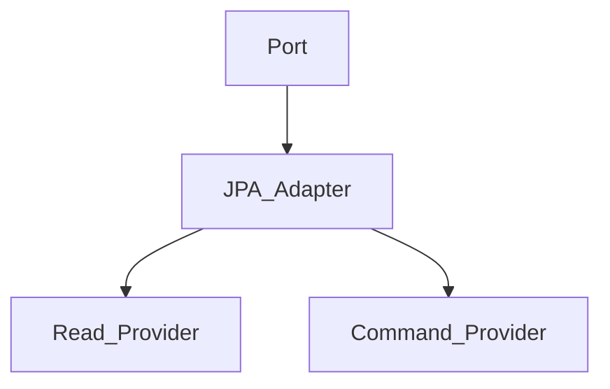

# Service — Provider와 CQRS

> **개요:** 제품명(Redis, Vault, Kafka)은 Port에 넣지 않고 Provider에 둡니다.
> CQRS의 코드 수준 적용점은 JPA Adapter입니다.
> 허브는 [데이터 접근 경계](/docs/knowledge/backend/service/service-design)입니다.

---

## Port → Adapter → Provider

| | 역할 |
|--|------|
| Port | 능력 계약 (`CachePort`, `EncryptionPort`, …) |
| Adapter | 직렬화·실패 의미 변환, Provider 선택 |
| Provider | Redis, Vault, Kafka 등 실제 호출 |

애플리케이션과 Port는 Provider 교체만으로 유지하는 것을 목표로 합니다.

---

## CQRS 적용점 = JPA Adapter

Facade가 읽기 DB·쓰기 DB를 고르지 않습니다.
Adapter가 Read/Command Provider로 Repository 접근을 나눌 수 있습니다.

처음부터 나누지 않아도 됩니다.
하나의 Port·Adapter·Repository로 시작하고 필요하면 분리합니다.
패턴 본편은 [CQRS](/docs/patterns/architecture-patterns/cqrs)입니다.
엔티티를 최소로 쓰는 원셋 결론은 Entity Knowledge의 minimal-and-cqrs와 맞물립니다.

---

## 관련

- [Port와 Adapter 역할](/docs/knowledge/backend/service/service-port-adapter-role)
- [CQRS](/docs/patterns/architecture-patterns/cqrs)
