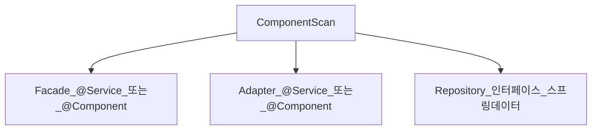

# Service — 스테레오타입과 스캔

> **개요:** Spring이 빈을 찾는 표식과, 원셋 Adapter·Facade에 무엇을 붙이는지를 적습니다.
> 허브는 [데이터 접근 경계](/docs/knowledge/backend/service/service-design)입니다.

---

## 스테레오타입

| 애너테이션 | 관례적 의미 |
|------------|-------------|
| `@Component` | 일반 컴포넌트 |
| `@Service` | 애플리케이션·도메인 쪽 서비스 빈 (의미 표식) |
| `@Repository` | 영속 접근. 일부 예외 변환 |
| `@Controller` / `@RestController` | 웹 진입 |

기술적으로 `@Service`·`@Repository`는 `@Component` 특수화에 가깝습니다.
팀 가독성과 AOP 포인트컷을 위해 역할을 맞춥니다.

원셋 Facade·JPA Adapter는 서비스 계층 빈으로 등록합니다.
Spring Data `JpaRepository` 인터페이스는 인프라가 구현체를 만듭니다.
직접 `@Repository`를 인터페이스에 중복으로 요란하게 붙일 필요는 호스트 관례를 따릅니다.

---

## 스캔

`@SpringBootApplication`이 보통 컴포넌트 스캔을 켭니다.
패키지 밖 Adapter는 `@ComponentScan` 범위를 맞춥니다.
스캔에 안 잡히면 “빈이 없다”로 DI가 실패합니다 — [DI 발전사](/docs/knowledge/backend/service/service-di-evolution)의 생성자 주입과 같이 보면 조기에 드러납니다.

---

## 관련

- [DI 발전사](/docs/knowledge/backend/service/service-di-evolution)
- [어디에 무엇을 주입하나](/docs/knowledge/backend/service/service-di-injection-points)
