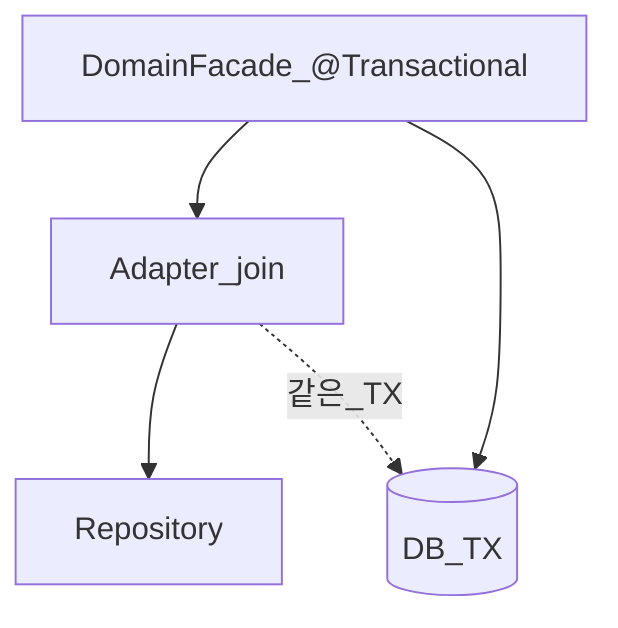

# Service — Facade DB TX에 join

> **개요:** 애플리케이션 동작 단위는 Facade가 정의합니다.
> 이 글은 Adapter의 DB `@Transactional`이 그 단위에 **어떻게 붙는지**만 다룹니다.
> 앱 TX ≠ DB TX 서사는 [Facade — 앱 동작 단위](/docs/knowledge/backend/facade/facade-app-unit-and-transactions)입니다.

---

## 규칙

[coding-conventions](/docs/harness/context/coding-conventions):

- Facade·JPA Adapter 클래스: `@Transactional(readOnly = true, transactionManager = "transactionManager")`
- 쓰기 메서드: `@Transactional` 오버라이드
- Adapter는 Facade TX에 **join** (새 경계를 함부로 열지 않음)
- Controller에서 TX 시작 금지

기본 전파(REQUIRED)면 Adapter 호출이 바깥 Facade TX에 참여합니다.
Adapter에서 `REQUIRES_NEW`로 쪼개면 도메인 앱 단위와 DB 단위가 어긋날 수 있습니다.
필요할 때만, 이유를 문서화합니다.

---

## readOnly와 쓰기

조회가 많은 Facade·Adapter는 클래스 기본을 readOnly로 두고, 저장·수정·삭제 메서드만 쓰기 TX로 올립니다.
실수로 읽기 전용 TX 안에서 변경하면 실패하거나 기대와 다른 flush가 납니다.

---

## 관련

- [Facade — 앱 동작 단위와 트랜잭션](/docs/knowledge/backend/facade/facade-app-unit-and-transactions)
- [데이터 접근 경계](/docs/knowledge/backend/service/service-design)
