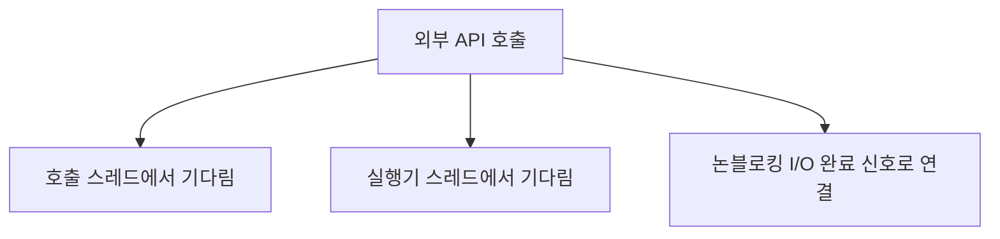

# 동기, 비동기와 논블로킹의 차이

동기와 비동기는 호출 결과를 받는 흐름에 관한 구분입니다.
블로킹과 논블로킹은 대기 중 실행 자원을 어떻게 사용하는지에 관한 구분입니다.
둘을 같은 단어로 쓰면 실행기에 넘긴 동기 요청을 논블로킹이라고 착각할 수 있습니다.

## 세 가지 대기 위치



```java
CompletableFuture<CatalogItem> future = CompletableFuture.supplyAsync(
        () -> blockingClient.find(id), executor);
```

명시적인 실행기를 사용하는 예제입니다.
호출 스레드는 먼저 반환받지만 executor의 작업 스레드는 상대 응답을 기다립니다.
큐와 작업자 수를 제한하지 않으면 처리량을 넘긴 요청이 메모리와 지연으로 쌓일 수 있습니다.

```java
Mono<CatalogItem> result = webClient.get().uri("/items/{id}", id)
        .retrieve().bodyToMono(CatalogItem.class);
```

WebClient 경로는 논블로킹 I/O와 Publisher 조합을 사용할 수 있습니다.
그러나 map 안에서 JDBC를 호출하면 그 부분은 다시 블로킹 작업입니다.
반환 타입이 Mono라는 이유로 전체 흐름이 안전한 것은 아닙니다.

| 코드 | 실제 주의점 |
|---|---|
| future.join() | 결과를 기다리는 호출 지점이 생깁니다. |
| mono.block() | 현재 스레드에서 완료를 기다립니다. |
| Mono.just(blockingCall()) | Publisher 생성 전에 호출이 실행됩니다. |
| fromCallable과 별도 스케줄러 | 블로킹을 옮기지만 작업 한도는 남습니다. |

## 논블로킹을 고르는 이유

많은 I/O 대기를 적은 플랫폼 스레드로 다루는 데 도움이 될 수 있습니다.
하지만 CPU, DB 연결과 상대 API 용량까지 늘리지는 않습니다.
동기 코드의 가시성이 중요하고 블로킹 자원이 많다면 MVC와 가상 스레드도 비교할 수 있습니다.

시험은 같은 동시 요청 수에서 스레드와 큐, 응답 지연과 오류를 함께 기록합니다.
정상 응답이 빠른 경우만 보면 차이가 드러나지 않을 수 있어 느린 상대도 포함합니다.

실행 모델은 [WebFlux 개요](https://docs.spring.io/spring-framework/reference/6.2/web/webflux/new-framework.html)와 [Reactor 블로킹 연결](https://projectreactor.io/docs/core/release/reference/faq.html#faq.wrap-blocking)을 참고합니다.

## 자주 묻는 질문

### 세 가지 대기 위치에서 무엇을 확인하나요?

최소 설정으로 동작을 확인한 뒤 확장합니다. 성공과 실패를 경로별로 기록합니다.

### 논블로킹을 고르는 이유에서 무엇을 확인하나요?

최소 설정으로 동작을 확인한 뒤 확장합니다. 성공과 실패를 경로별로 기록합니다.
