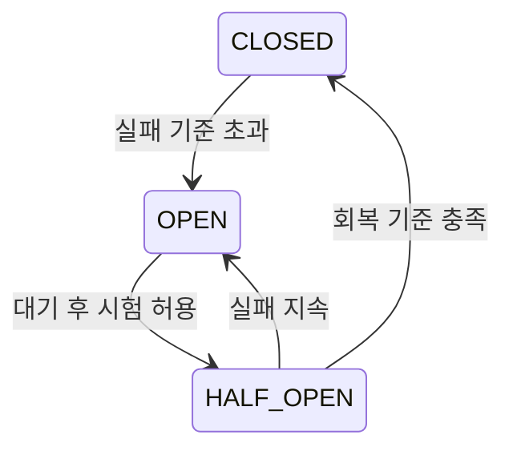

# Circuit Breaker와 Resilience4j

상대 서비스가 계속 실패하는데 모든 요청이 같은 대기를 반복하면 호출 앱까지 자원이 고갈될 수 있습니다.
Circuit Breaker는 최근 호출 결과를 기준으로 잠시 호출을 막고 회복을 확인하는 방법입니다.
Spring Cloud Circuit Breaker는 이 기능을 구현 라이브러리와 연결하는 공통 API를 제공합니다.



Resilience4j의 대표 상태 모델입니다.
CLOSED는 호출 통과, OPEN은 호출 차단을 뜻하므로 이름을 차단기의 물리 개방과 혼동하지 않습니다.
최소 호출 수와 집계 창이 있어 한 번의 오류가 항상 OPEN으로 이어지지는 않습니다.

```groovy
implementation 'org.springframework.cloud:spring-cloud-starter-circuitbreaker-resilience4j'
```

```java
CatalogItem item = factory.create("catalogRead").run(
        () -> client.find(id),
        failure -> fallback.findCached(id));
```

CircuitBreakerFactory, 클라이언트와 fallback이 주입됐다는 전제의 동기 예제입니다.
리액티브 Gateway에는 Reactor 통합 의존성과 반환 타입을 사용합니다.
fallback은 실제로 허용된 대체 동작이어야 하며 실패한 결제에 성공 응답을 만드는 식으로 쓰지 않습니다.

| 설정 관점 | 결정할 내용 |
|---|---|
| 실패 분류 | 업무상 거절을 장애로 셀지 |
| 집계 창과 최소 호출 | 어느 기간과 표본으로 판단할지 |
| 차단과 시험 호출 | 회복을 언제 어떻게 확인할지 |
| 관측 | 차단, 실제 오류와 fallback 사용량 |

Circuit Breaker는 동시 요청 수 제한과 다릅니다.
닫힌 상태에서도 요청이 많이 몰릴 수 있어 Bulkhead 등 별도 한도가 필요할 수 있습니다.
타임아웃으로 대기가 끝나도 실제 원격 쓰기가 취소됐다고 단정할 수 없습니다.

테스트는 실패율을 충분히 만든 뒤 차단 시 상대가 실제로 호출되지 않는지 확인합니다.
시간이 지나면 시험 호출과 회복이 일어나는지도 확인합니다.

구현 연결은 [Cloud Circuit Breaker](https://docs.spring.io/spring-cloud-circuitbreaker/reference/), 상태와 설정은 [Resilience4j](https://resilience4j.readme.io/docs/circuitbreaker)를 참고합니다.

## 자주 묻는 질문

### Circuit Breaker와 Resilience4j에서 무엇을 확인하나요?

클라이언트 선택과 장애 제어는 호출 모델과 함께 봅니다. 동기 호출이라는 이유만으로 대체 여부를 단정하지 않습니다.

### Circuit Breaker와 Resilience4j 적용 시 확인할 점에서 무엇을 확인하나요?

클라이언트 선택과 장애 제어는 호출 모델과 함께 봅니다. 동기 호출이라는 이유만으로 대체 여부를 단정하지 않습니다.
