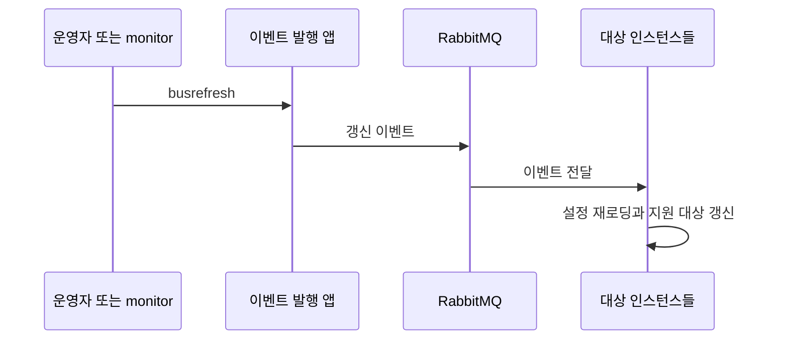

# Bus와 RabbitMQ로 변경 이벤트 전파

앱이 여러 대이면 각 서버에 refresh 요청을 따로 보내는 대신 Bus로 이벤트를 전파할 수 있습니다.
RabbitMQ는 전달 경로이고 Spring Cloud Bus는 어떤 앱에 어떤 관리 이벤트를 전달할지 연결합니다.
설정 데이터 자체를 항상 메시지 본문으로 배포하는 방식은 아닙니다.

```groovy
implementation 'org.springframework.cloud:spring-cloud-starter-bus-amqp'
implementation 'org.springframework.boot:spring-boot-starter-actuator'
```

```yaml
spring:
  application:
    name: catalog
  rabbitmq:
    host: localhost
    username: ${RABBIT_USERNAME}
    password: ${RABBIT_PASSWORD}
management:
  endpoints:
    web:
      exposure:
        include: health,busrefresh
```

브로커와 관리 API의 인증이 구성된 로컬 예제입니다.
외부 설정은 별도로 Config Client 등으로 연결해야 합니다.
앱들이 서로 다른 인스턴스로 식별되는지도 확인합니다.



Config Server에서 Git webhook을 처리하려면 `spring-cloud-config-monitor`와 Bus 연결을 구성합니다.
수동 요청에서 시작해 자동 감지 경로를 추가하면 어떤 단계가 실패했는지 구분하기 쉽습니다.

| 성공 신호 | 아직 별도로 확인할 것 |
|---|---|
| 관리 API가 응답함 | 메시지 발행과 전달 여부 |
| 이벤트를 수신함 | 외부 설정 재조회 성공 |
| 바인딩이 갱신됨 | 실제 기능의 적용 결과 |

모든 인스턴스가 같은 순간에 바뀌는 강한 동시 적용을 보장하지 않습니다.
필요하면 설정 revision을 기록하고 인스턴스별 적용 상태를 수집합니다.
관리 이벤트가 누락됐을 때 재시작이나 재발행으로 어떻게 수렴할지도 정합니다.

동작은 [Bus Endpoints](https://docs.spring.io/spring-cloud-bus/reference/spring-cloud-bus/bus-endpoints.html), 자동 감지는 [Config Push Notifications](https://docs.spring.io/spring-cloud-config/reference/server/push-notifications-and-bus.html)를 참고합니다.

## 자주 묻는 질문

### Bus와 RabbitMQ로 변경 이벤트 전파에서 무엇을 확인하나요?

설정 로딩, 이벤트 전파와 실제 빈 갱신 가능 범위를 나눠 확인합니다.

### Bus와 RabbitMQ로 변경 이벤트 전파 적용 시 확인할 점에서 무엇을 확인하나요?

설정 로딩, 이벤트 전파와 실제 빈 갱신 가능 범위를 나눠 확인합니다.
