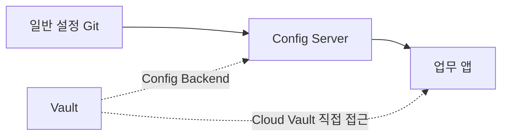

# Config와 Vault의 역할 및 조합

Config도 암호화된 비밀번호를 제공할 수 있고 Vault도 설정처럼 값을 읽을 수 있습니다.
선택 기준은 값을 숨긴다는 공통점보다 관리할 책임에 있습니다.
환경별 설정의 배포와 비밀에 대한 접근 및 수명을 구분해 봅니다.

| 질문 | Config에서 볼 것 | Vault에서 볼 것 |
|---|---|---|
| 앱별 설정을 어디서 제공하나요? | 앱, 프로필과 label | 경로와 정책 |
| Git에 평문을 남기고 싶지 않아요. | cipher 값과 복호화 키 | 비밀 저장과 접근 API |
| 주체별 접근을 제한하고 싶어요. | 설정 API의 인증 및 권한 | 신원 인증과 세밀한 policy |
| 임시 DB 계정이 필요해요. | 단순 값 제공만으로 충분한지 검토 | 지원 엔진의 발급, lease와 폐기 |

## 직접 읽기와 중계



직접 접근에서는 앱이 Vault에 인증합니다.
중계 방식에서는 Config의 Vault Backend 인증 구조와 앱별 전달 권한을 정합니다.
한 서버가 모든 비밀을 광범위하게 읽고 모든 앱에 제공하도록 만들지 않습니다.

```yaml
spring:
  profiles:
    active: vault
  cloud:
    config:
      server:
        vault:
          host: ${VAULT_HOST}
          port: 8200
          scheme: https
          kv-version: 2
```

Config Server가 Vault Backend를 선택하는 부분 예제입니다.
인증과 정책, 인증서 및 실제 비밀 경로는 별도로 구성해야 합니다.
Git과 Vault를 동시에 사용하는 composite 구성은 출처 간 우선순위도 명시합니다.

## 갱신은 별도 설계입니다

Git 값 변경과 Vault 자격 증명 회전은 같은 이벤트가 아닐 수 있습니다.
Config와 Bus를 연결했다고 모든 비밀 엔진의 회전이 앱에 전달되는 것은 아닙니다.
누가 변경을 감지하고 실제 클라이언트 객체를 교체할지 정합니다.

학습에서는 일반 표시값과 비밀값을 서로 다른 경로로 읽어 출처를 확인합니다.
운영 검증에서는 권한 없는 앱의 조회 거절, Vault 장애와 비밀 회전 후의 접속을 확인합니다.

지원 범위는 [Config Vault Backend](https://docs.spring.io/spring-cloud-config/reference/server/environment-repository/vault-backend.html)와 [Vault lease](https://developer.hashicorp.com/vault/docs/concepts/lease)를 참고합니다.

## 자주 묻는 질문

### 직접 읽기와 중계에서 무엇을 확인하나요?

최소 설정으로 동작을 확인한 뒤 확장합니다. 성공과 실패를 경로별로 기록합니다.

### 갱신은 별도 설계입니다에서 무엇을 확인하나요?

최소 설정으로 동작을 확인한 뒤 확장합니다. 성공과 실패를 경로별로 기록합니다.
