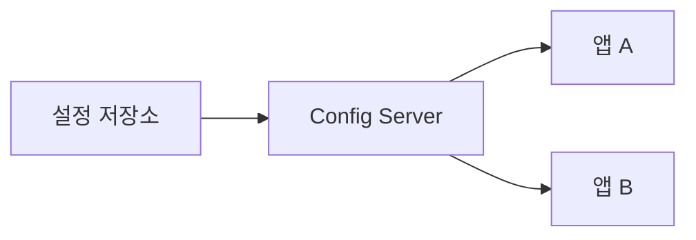

# Config Server와 설정 저장소

Config Server는 여러 앱의 설정을 일정한 API로 제공합니다.
설정의 저장 위치를 앱에서 분리하면 같은 산출물을 환경별 값으로 실행하기 쉽습니다.
중앙화한 만큼 서버 접근과 설정 변경 권한도 운영 대상이 됩니다.

## 서버와 저장소를 연결합니다

Cloud Config 4.3의 서버 앱을 기준으로 합니다.
Boot와 Cloud BOM은 이미 적용돼 있다고 가정합니다.

```groovy
implementation 'org.springframework.cloud:spring-cloud-config-server'
```

```java
@SpringBootApplication
@EnableConfigServer
public class ConfigApplication {
    public static void main(String[] args) {
        SpringApplication.run(ConfigApplication.class, args);
    }
}
```

```yaml
server:
  port: 8888
spring:
  cloud:
    config:
      server:
        git:
          uri: ${CONFIG_REPOSITORY_URI}
          default-label: main
```

저장소가 비공개라면 읽기 인증을 별도로 주입합니다.
토큰을 URI에 붙여 로그에 남기지 않고 서버의 인증 및 전송 정책을 정합니다.

## 앱, 프로필과 label

```text
GET /catalog/local/main
```

위 요청은 catalog 앱의 local 프로필을 main label에서 조회하는 형태입니다.
Git에서는 label이 브랜치나 태그 등에 대응할 수 있습니다.
공통 application 설정과 앱별 설정이 어떻게 합쳐지는지 응답의 propertySources를 확인합니다.



파일명이 같다는 이유로 모든 앱이 같은 값을 받는 것은 아닙니다.
앱 이름, 활성 프로필과 label을 운영 기록에 함께 남깁니다.
잘못된 label을 배포하면 정상 서버에서 잘못된 설정을 읽는 결과가 생길 수 있습니다.

**과거 학습 예제:** [configserver](https://github.com/No1stone/configserver)는 이전에 Config Server를 직접 구성하며 남긴 저장소입니다.
과거 예제의 Boot 버전과 설정 로딩 방식은 현재 예제와 구분해 확인합니다.

테스트는 실제 서버의 설정 조회, 클라이언트 바인딩과 변경 반영을 단계별로 진행합니다.
설정 서버 응답 성공만으로 실제 앱이 그 값을 사용했다고 판단하지 않습니다.
저장소 연결 실패와 클라이언트가 재기동할 때의 정책도 시험합니다.

백엔드와 파일 선택은 [Config Server 공식 문서](https://docs.spring.io/spring-cloud-config/reference/server.html)를 참고합니다.

## 자주 묻는 질문

### 서버와 저장소를 연결합니다에서 무엇을 확인하나요?

최소 설정으로 동작을 확인한 뒤 확장합니다. 성공과 실패를 경로별로 기록합니다.

### 앱, 프로필과 label에서 무엇을 확인하나요?

최소 설정으로 동작을 확인한 뒤 확장합니다. 성공과 실패를 경로별로 기록합니다.
