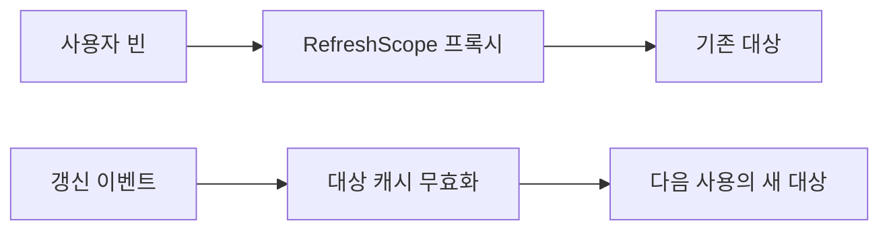

# RefreshScope와 실제 갱신 가능 범위

설정값을 다시 읽는 것과 그 값을 사용하던 객체를 바꾸는 것은 다릅니다.
생성자에서 URL을 읽어 클라이언트를 만들었다면 문자열이 갱신돼도 기존 연결 객체가 계속 사용될 수 있습니다.
RefreshScope는 이런 객체의 재생성 경로를 제공하지만 모든 빈에 적용할 수 있는 만능 재시작 기능은 아닙니다.

## 프록시 뒤의 대상을 바꿉니다

```java
@Bean
@RefreshScope
CatalogEndpoint catalogEndpoint(@Value("${catalog.endpoint}") String endpoint) {
    return new CatalogEndpoint(endpoint);
}
```

`CatalogEndpoint`는 설정값을 보관하는 예제 클래스입니다.
갱신에서 scope의 대상 캐시가 무효화되고 다음 사용 때 새 대상을 만들 수 있습니다.
실행 중 모든 요청이 한 시점에 새 객체를 받는다는 의미로 해석하지 않습니다.



## ConfigurationProperties와 역할이 다릅니다

| 기능 | 중심 동작 |
|---|---|
| Environment 갱신 | 새 설정 출처와 값 읽기 |
| 설정 속성 재바인딩 | 지원되는 설정 객체에 반영 |
| RefreshScope | 대상 객체 생명주기 갱신 |
| 라우트 캐시 refresh | Gateway의 실행 라우트 재구성 |

일반 @Value 필드와 불변 객체, 외부 SDK와 연결 풀은 모두 같은 방식으로 바뀌지 않습니다.
HikariDataSource 등 기본적으로 갱신 불가로 분류되는 대상도 있습니다.
DB 비밀번호를 바꿨다고 기존 연결이 새 비밀번호로 다시 인증하는 것은 아닙니다.

새 객체가 만들어질 때 필요한 외부 연결이 실패하면 갱신 이후 호출이 실패할 수 있습니다.
이전 대상의 정리와 진행 중 작업의 생명주기도 검토합니다.
설정 클래스에 RefreshScope를 붙였다고 그 안의 모든 빈에 자동으로 같은 의미가 전파된다고 가정하지 않습니다.

테스트는 초기값 사용, 갱신 직전 동시 요청, 갱신 후 새 값과 재생성 실패를 나눕니다.
애플리케이션 컨텍스트 전체 재시작과 특정 빈 갱신은 다른 비용과 실패 범위입니다.

제약은 [Refresh Scope 공식 문서](https://docs.spring.io/spring-cloud-commons/reference/spring-cloud-commons/application-context-services.html)를 기준으로 확인합니다.

## 자주 묻는 질문

### 프록시 뒤의 대상을 바꿉니다에서 무엇을 확인하나요?

최소 설정으로 동작을 확인한 뒤 확장합니다. 성공과 실패를 경로별로 기록합니다.

### ConfigurationProperties와 역할이 다릅니다에서 무엇을 확인하나요?

설정 로딩, 이벤트 전파와 실제 빈 갱신 가능 범위를 나눠 확인합니다.
