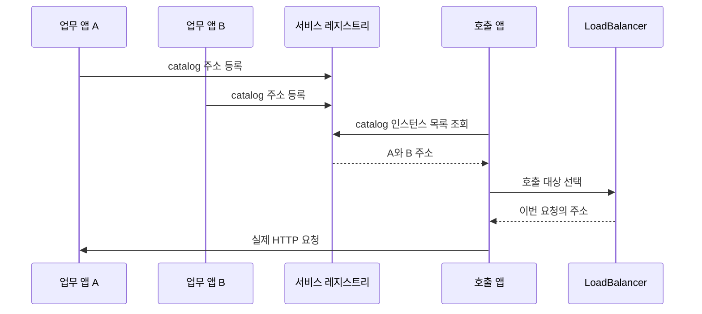
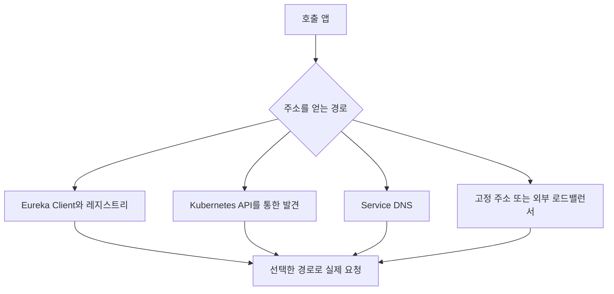

# 서비스 발견과 로드밸런싱

서비스 이름으로 다른 앱을 호출하려면 이름에 대응하는 주소를 얻어야 합니다.
주소가 여러 개라면 이번 요청을 어느 인스턴스에 보낼지도 선택해야 합니다.
서비스 발견과 로드밸런싱은 이 두 책임을 나눠 설명하는 개념입니다.

## Eureka가 목록에서 안 보이는 이유

Spring Cloud의 Eureka 통합은 [spring-cloud-netflix](https://github.com/spring-cloud/spring-cloud-netflix)에 포함돼 있습니다.
Eureka라는 최상위 프로젝트 이름이 없다고 Zookeeper로 교체된 것은 아닙니다.
Eureka의 원래 구현 프로젝트와 Spring에서 사용하기 위한 통합 프로젝트도 구분합니다.

| 이름 | 관계 |
|---|---|
| Netflix Eureka | 서비스 레지스트리와 클라이언트의 기반 기술입니다. |
| Spring Cloud Netflix | Eureka를 Spring Boot 앱과 연결하는 통합을 제공합니다. |
| Spring Cloud Zookeeper | Apache Zookeeper를 발견 및 설정 기반으로 사용합니다. |
| Spring Cloud Consul | Consul을 발견 및 설정 기반으로 사용합니다. |
| Spring Cloud Commons | DiscoveryClient 같은 공통 계약을 제공합니다. |

현재 Netflix 저장소 이름만 보고 과거 Hystrix, Ribbon과 Zuul 구성을 모두 같은 방식으로 가져오지 않습니다.
지원 기능은 사용하는 버전의 [Netflix 공식 문서](https://docs.spring.io/spring-cloud-netflix/reference/spring-cloud-netflix.html)를 기준으로 확인합니다.

## 등록, 발견과 선택의 세 단계



이 그림에서 레지스트리는 주소 정보를 제공합니다.
실제 업무 HTTP 요청이 항상 레지스트리를 통과하는 것은 아닙니다.
클라이언트가 목록을 캐시할 수도 있으므로 주소 변경과 장애 반영에 시간차가 생길 수 있습니다.

| 단계 | 질문 | 대표 담당 |
|---|---|---|
| 등록 | 이 서비스의 인스턴스는 어디에 있나요? | 앱과 레지스트리 |
| 발견 | 사용할 수 있는 주소는 무엇인가요? | DiscoveryClient |
| 선택 | 이번 호출을 어느 주소로 보낼까요? | LoadBalancer |
| 실행 | 실제 요청을 어떻게 보낼까요? | HTTP 클라이언트 또는 Gateway |

## lb URI는 Eureka의 전용 주소가 아닙니다

```text
lb://catalog-service
```

Gateway 설정에서 위와 같은 URI를 사용하면 서비스 ID를 실제 인스턴스에 연결하는 부하 분산 경로를 사용합니다.
이 문자열 자체가 Eureka를 선택하는 것은 아닙니다.
사용 중인 발견 구현과 LoadBalancer 구성, 정적 인스턴스 목록 등 실제 주소 공급 방식을 확인해야 합니다.

Eureka 클라이언트는 서버 주소를 설정하고 앱 이름과 주소를 등록합니다.
서버를 만들 때와 클라이언트를 붙일 때는 다른 Starter를 사용합니다.

```groovy
// Eureka 서버 앱의 dependencies 블록에 추가합니다.
implementation 'org.springframework.cloud:spring-cloud-starter-netflix-eureka-server'
```

```groovy
// 등록과 조회가 필요한 클라이언트 앱에 추가합니다.
implementation 'org.springframework.cloud:spring-cloud-starter-netflix-eureka-client'
```

Boot와 Cloud BOM이 호환되게 구성돼 있다는 전제의 부분 예제입니다.
서버에는 `@EnableEurekaServer` 등 서버 구성이 필요하고, 클라이언트에는 접근할 서버 주소와 등록 정책이 필요합니다.
의존성 두 줄을 추가했다고 네트워크, 보안과 이중화 구성이 완성되지는 않습니다.

## Kubernetes의 발견 경로와 비교합니다

Kubernetes에서는 Service 이름과 DNS로 접근할 수 있습니다.
예를 들어 같은 namespace의 앱이 `http://catalog-service:8080`으로 호출하면 서비스 이름을 사용하지만 Eureka에 등록하는 흐름은 아닙니다.
Service와 endpoint 구성에 따라 플랫폼의 트래픽 전달 경로가 동작합니다.



위 경로들은 목적과 환경에 따른 선택지입니다.
Kubernetes API를 직접 조회하는 앱은 Service DNS만 사용하는 앱과 필요한 RBAC 권한이 다를 수 있습니다.
Pod별 주소와 메타데이터가 필요한지, 안정적인 서비스 주소만 있으면 되는지 먼저 판단합니다.
[Spring Cloud Kubernetes 공식 안내](https://docs.spring.io/spring-cloud-kubernetes/reference/)도 해당 프로젝트가 Boot 앱 배포의 필수 조건은 아니라고 설명합니다.

## 장애 판단과 권한은 따로 봅니다

서비스 등록이 살아 있다는 사실과 특정 업무 API가 정상이라는 사실은 다릅니다.
heartbeat, 캐시와 등록 해제 지연 때문에 일시적으로 실패한 인스턴스를 선택할 수도 있습니다.
호출 타임아웃과 실패 처리, 필요하면 health check와 재시도 정책을 별도로 설계합니다.
쓰기 요청의 재시도에는 중복 실행 방지 기준도 필요합니다.

레지스트리는 사용자별 API 접근 권한을 판정하는 시스템이 아닙니다.
서비스 이름을 알 수 있다고 호출 권한이 생기는 것은 아니며, 네트워크와 서비스 간 인증을 별도 경계로 둡니다.
레지스트리 접근 역시 내부 통신이라고 무조건 공개하지 않습니다.

확인할 때는 등록 성공, 인스턴스 추가와 종료, 레지스트리 접근 실패 및 캐시된 주소의 동작을 나눠 시험합니다.
주소 조회 성공과 실제 API 성공을 별도로 기록해야 장애 위치를 찾기 쉽습니다.

발견과 heartbeat는 [Eureka 공식 문서](https://docs.spring.io/spring-cloud-netflix/reference/spring-cloud-netflix.html), 주소 선택은 [Spring Cloud LoadBalancer](https://docs.spring.io/spring-cloud-commons/reference/spring-cloud-commons/loadbalancer.html)를 참고합니다.

## 자주 묻는 질문

### Eureka가 목록에서 안 보이는 이유에서 무엇을 확인하나요?

등록, 발견과 주소 선택은 책임이 다릅니다. Server와 Client 설정을 구분해 확인합니다.

### 등록, 발견과 선택의 세 단계에서 무엇을 확인하나요?

등록, 발견과 주소 선택은 책임이 다릅니다. Server와 Client 설정을 구분해 확인합니다.
