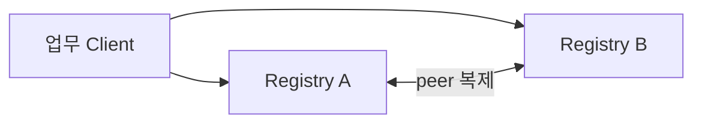

# Eureka 다중화와 서버 간 연결

Eureka 서버를 여러 개 운영하면 한 서버가 내려갔을 때 등록과 조회 경로를 유지할 수 있습니다.
각 서버는 peer로 연결돼 등록 정보를 서로 복제합니다.
이를 DB의 리더 한 대에만 쓰는 구조나 강한 일관성의 합의 시스템과 같은 의미로 보지는 않습니다.

## 서버끼리 연결하고 클라이언트도 여러 주소를 압니다



다음은 같은 서버 앱을 다른 hostname으로 실행하는 개념 예제입니다.
A에서 B로, B에서 A로 네트워크 접근과 이름 해석이 가능해야 합니다.

```yaml
# Registry A
spring:
  application:
    name: registry
eureka:
  instance:
    hostname: registry-a
  client:
    serviceUrl:
      defaultZone: http://registry-b:8761/eureka/
```

B에서는 hostname을 `registry-b`로, 상대 주소를 `registry-a`로 바꿉니다.
독립 서버 예제의 register-with-eureka와 fetch-registry false를 그대로 남기지 말고 peer 구성 의도를 확인합니다.
클라이언트에는 접속할 서버 주소들을 제공합니다.

```yaml
eureka:
  client:
    serviceUrl:
      defaultZone: http://registry-a:8761/eureka/,http://registry-b:8761/eureka/
```

## 두 대 실행과 장애 도메인은 다릅니다

| 확인 항목 | 이유 |
|---|---|
| 서로 다른 장애 도메인 | 같은 호스트가 꺼져 모두 멈추는 상황을 줄입니다. |
| peer 연결 | 서버 간 목록 복제 경로입니다. |
| 클라이언트 대체 접속 | 한 주소 장애 후 다른 서버를 사용할 수 있어야 합니다. |
| 광고 주소 | 등록된 업무 앱에 호출자가 도달해야 합니다. |

서버 둘을 같은 노트북에 띄우면 복제와 접속 전환은 학습할 수 있지만 호스트 장애까지 견디는 운영 구성을 검증한 것은 아닙니다.
분할된 네트워크에서는 각 서버와 클라이언트가 다른 목록을 잠시 볼 수 있습니다.

시험은 한 서버 종료, peer 사이만 단절, 새 앱 등록과 기존 앱 호출을 나눠 진행합니다.
클라이언트에 캐시가 있어 서버 종료 직후 호출이 성공할 수 있으므로 정상 등록 경로가 유지되는지도 따로 확인합니다.
복구 후 목록이 수렴하는 시간과 불필요한 중복 등록도 봅니다.

peer 구조와 제약은 [Eureka 공식 아키텍처 설명](https://docs.spring.io/spring-cloud-netflix/reference/4.3/spring-cloud-netflix.html)을 참고합니다.

## 자주 묻는 질문

### 서버끼리 연결하고 클라이언트도 여러 주소를 압니다에서 무엇을 확인하나요?

최소 설정으로 동작을 확인한 뒤 확장합니다. 성공과 실패를 경로별로 기록합니다.

### 두 대 실행과 장애 도메인은 다릅니다에서 무엇을 확인하나요?

최소 설정으로 동작을 확인한 뒤 확장합니다. 성공과 실패를 경로별로 기록합니다.
