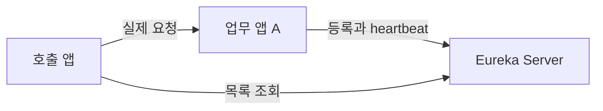

# Eureka Server 의존성과 기본 구성

Eureka Server는 서비스 이름과 인스턴스 주소를 보관하는 레지스트리입니다.
업무 요청을 중계하는 API Gateway와는 다릅니다.
호출 앱은 레지스트리에서 얻은 주소로 상대에게 직접 요청할 수 있습니다.

## 서버 앱을 따로 구성합니다

Boot와 Cloud BOM이 호환되게 적용된 Gradle 프로젝트를 전제로 합니다.
이 예제는 Cloud Netflix 4.3 계열의 기본 서버 구성을 설명합니다.

```groovy
implementation 'org.springframework.cloud:spring-cloud-starter-netflix-eureka-server'
```

```java
@SpringBootApplication
@EnableEurekaServer
public class RegistryApplication {
    public static void main(String[] args) {
        SpringApplication.run(RegistryApplication.class, args);
    }
}
```

```yaml
server:
  port: 8761
spring:
  application:
    name: registry
eureka:
  client:
    register-with-eureka: false
    fetch-registry: false
```

두 false는 독립 서버 예제에서 자기 자신을 다른 서버에 등록하거나 목록을 가져오는 동작을 끕니다.
서버 다중화 예제에서는 peer 연결을 위해 설정이 달라집니다.
이 값을 모든 Eureka 서버의 기본 운영값으로 복사하지 않습니다.

## 서버가 저장하는 것

| 정보 | 용도 |
|---|---|
| 서비스 ID | 같은 기능을 제공하는 앱을 묶습니다. |
| 인스턴스 ID와 주소 | 실제 호출 위치를 식별합니다. |
| 상태와 갱신 정보 | 등록의 유지와 제거 판단에 사용합니다. |



대시보드에 등록됐다는 사실만으로 업무 API의 정상 동작까지 검증한 것은 아닙니다.
등록 주소가 호출 앱에서 도달 가능한 주소인지도 확인합니다.
컨테이너 내부 hostname이나 잘못된 포트가 광고되면 등록은 성공해도 호출은 실패할 수 있습니다.

서버 접근은 인증과 네트워크 정책으로 제한합니다.
비밀이 없는 내부 메타데이터라고 하더라도 서비스 주소와 운영 상태를 무제한 공개할 이유는 없습니다.
서버 재시작, 클라이언트 등록 및 목록 조회를 구분해 시험합니다.

서버 동작과 다중화는 [Netflix 공식 문서](https://docs.spring.io/spring-cloud-netflix/reference/4.3/spring-cloud-netflix.html)를 참고합니다.

## 과거 학습 예제

[eurekaserver](https://github.com/No1stone/eurekaserver)는 이전에 Eureka Server를 직접 구성하며 남긴 학습 저장소입니다.
현재 프로젝트의 서비스 발견 방식이나 권장 버전을 뜻하는 자료는 아니며, 서버 구성의 기본 흐름을 확인하는 예제로 읽습니다.

## 자주 묻는 질문

### 서버 앱을 따로 구성합니다에서 무엇을 확인하나요?

최소 설정으로 동작을 확인한 뒤 확장합니다. 성공과 실패를 경로별로 기록합니다.

### 서버가 저장하는 것에서 무엇을 확인하나요?

최소 설정으로 동작을 확인한 뒤 확장합니다. 성공과 실패를 경로별로 기록합니다.
