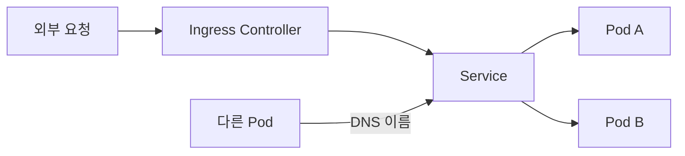

# Kubernetes Service와 DNS가 맡는 역할

Kubernetes에서는 Service가 Pod 집합에 안정적인 접근 지점을 제공합니다.
Pod 주소가 바뀌더라도 호출 앱은 Service 이름을 사용할 수 있습니다.
이 요구가 충족되면 별도 Eureka를 운영하지 않을 수 있습니다.

## Service와 외부 진입점을 나눕니다



Ingress는 외부 HTTP 라우팅 규칙이고 Controller가 그 규칙을 구현합니다.
주소 발견에서 Eureka와 직접 비교할 부분은 주로 Service와 DNS입니다.
Ingress만 추가해서 내부 서비스 발견을 해결했다고 설명하지 않습니다.

```yaml
apiVersion: v1
kind: Service
metadata:
  name: catalog
spec:
  selector:
    app: catalog
  ports:
    - port: 8080
      targetPort: 8080
```

동일 namespace의 앱은 `http://catalog:8080`으로 접근하는 구성을 만들 수 있습니다.
이름은 클러스터의 DNS 정책과 namespace에 따라 해석됩니다.
위 예제는 대응하는 Pod와 readiness, 네트워크 접근이 준비됐다는 전제입니다.

| 접근 방식 | 앱이 알아야 할 정보 |
|---|---|
| 일반 Service DNS | 서비스 이름과 포트 |
| Headless Service | DNS 결과와 호출 측의 인스턴스 선택 요구 |
| Kubernetes API 기반 발견 | API 접근 권한과 조회 범위 |
| Eureka | 레지스트리 주소와 등록 및 캐시 정책 |

Service DNS로 충분하면 Cloud Kubernetes의 DiscoveryClient도 반드시 넣을 필요는 없습니다.
반대로 인스턴스 메타데이터와 Pod별 선택이 필요하다면 API 기반 발견을 검토할 수 있습니다.
클러스터 밖과 안을 연결할 때는 주소 도달성과 인증 경계도 확인합니다.

테스트는 Pod 교체, readiness 실패와 Service selector 오류를 나눠 봅니다.
DNS가 해석됐는데 endpoint가 없으면 실제 요청은 실패할 수 있습니다.

기본 개념은 [Service](https://kubernetes.io/docs/concepts/services-networking/service/)와 [서비스 DNS](https://kubernetes.io/docs/concepts/services-networking/dns-pod-service/)를 참고합니다.

## 자주 묻는 질문

### Service와 외부 진입점을 나눕니다에서 무엇을 확인하나요?

Kubernetes Service와 DNS의 역할은 Eureka 생략 여부를 판단하는 기준입니다. Ingress가 Eureka를 직접 대체한다고 보지 않습니다.

### Kubernetes Service와 DNS가 맡는 역할 적용 시 확인할 점에서 무엇을 확인하나요?

Kubernetes Service와 DNS의 역할은 Eureka 생략 여부를 판단하는 기준입니다. Ingress가 Eureka를 직접 대체한다고 보지 않습니다.
