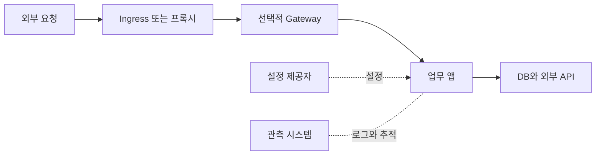

# 실행 환경별 대표 구성과 조합

분산 시스템 구성은 기능을 많이 붙이는 순서로 정하지 않습니다.
현재 환경에서 누가 주소, 설정과 장애 대응을 맡는지 확인한 뒤 빈 부분을 채웁니다.
같은 Spring 앱이라도 로컬, VM과 Kubernetes에서 필요한 조합은 달라질 수 있습니다.

## 환경별로 책임을 배치합니다

| 환경 | 주소 접근 | 설정 | 함께 검토할 기능 |
|---|---|---|---|
| 로컬 단일 앱 | 고정 URL | 파일과 환경 변수 | 실제 외부 계약의 더미 |
| 여러 VM | 고정 VIP 또는 레지스트리 | Config, Vault 등 | LoadBalancer와 실패 제어 |
| Kubernetes | Service와 DNS | ConfigMap, 외부 설정과 Vault | RBAC, readiness와 메시 |

Kubernetes에서도 앱 내부의 fallback이나 특정 업무 예외 분류는 필요할 수 있습니다.
반대로 VM이라고 반드시 Eureka가 필요한 것은 아닙니다.
안정적인 외부 로드밸런서 주소만으로 충분할 수도 있습니다.

이 그림은 선택지를 배치한 지도이며 모든 요소가 필수라는 뜻은 아닙니다.
Ingress와 Gateway를 함께 쓴다면 TLS와 도메인 분기, 앱별 정책을 어느 쪽에 둘지 정합니다.
같은 재시도를 여러 층에서 적용하면 실제 호출 횟수가 곱으로 늘 수 있습니다.

## 구성 전에 적어 볼 질문

주소가 바뀌면 누가 알아내는지, 상대가 느릴 때 누가 기다림을 끝내는지부터 적습니다.
다음으로 설정 변경을 언제 적용하고 실패한 인스턴스를 어떻게 찾을지 정합니다.
로그와 trace ID가 연결되지 않으면 장애 요청을 따라가기 어려워집니다.

기본 구성은 정상 요청 한 건으로 시작하고 상대 종료, 잘못된 설정과 재시작을 차례로 시험합니다.
운영 도구를 설치했다는 사실과 그 장애 경로가 검증됐다는 사실을 나눠 기록합니다.

공통 패턴은 [Spring Cloud 소개](https://spring.io/projects/spring-cloud/), Kubernetes에서 앱에 필요한 범위는 [공식 통합 안내](https://docs.spring.io/spring-cloud-kubernetes/reference/)를 참고합니다.

## 자주 묻는 질문

### 환경별로 책임을 배치합니다에서 무엇을 확인하나요?

최소 설정으로 동작을 확인한 뒤 확장합니다. 성공과 실패를 경로별로 기록합니다.

### 구성 전에 적어 볼 질문에서 무엇을 확인하나요?

최소 설정으로 동작을 확인한 뒤 확장합니다. 성공과 실패를 경로별로 기록합니다.
