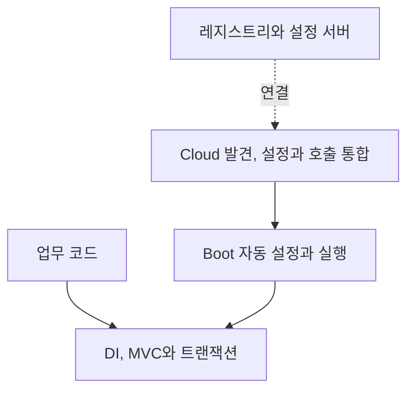

# Framework, Boot, Cloud의 관계

Spring Cloud를 사용해도 객체 생성과 HTTP 처리는 Spring Framework 위에서 실행됩니다.
Boot는 그 객체와 기술을 실행 가능한 앱으로 구성하고, Cloud는 여러 앱을 연결할 때 필요한 기능을 보탭니다.
한쪽이 다른 쪽을 대체하는 관계로 이해하지 않는 것이 출발점입니다.

## 한 번의 호출에 세 층이 참여합니다



예를 들어 Feign 인터페이스를 등록하는 것은 Cloud 통합 기능이고, 그 객체를 주입하는 기반은 Framework입니다.
어떤 구현을 자동으로 구성하고 실행할지는 Boot 설정과 classpath 조건도 관여합니다.
Cloud라는 이름이 있다고 모든 실행이 비동기나 원격 처리로 바뀌지는 않습니다.

| 관심사 | 예시 | 프로젝트가 결정할 부분 |
|---|---|---|
| Framework | 빈과 AOP | 업무 책임과 트랜잭션 경계 |
| Boot | 자동 설정과 Starter | 사용할 기술과 환경별 값 |
| Cloud | 서비스 발견과 설정 제공 | 네트워크 경계와 실패 정책 |

## 의존성 한 줄 뒤에 있는 구성

```groovy
// Boot와 Cloud BOM을 이미 적용한 앱의 일부입니다.
implementation 'org.springframework.cloud:spring-cloud-starter-config'
```

이 의존성은 Config Server를 앱 안에 설치하는 명령이 아닙니다.
앱이 서버에서 설정을 읽도록 지원하는 Client 기능입니다.
서버 주소, 인증과 실패 시 기동 정책은 추가로 정해야 합니다.
같은 방식으로 Eureka Client를 넣는 것과 Eureka Server 앱을 만드는 것도 다릅니다.

버전은 [Starter와 Release Train](./starters-and-release-train.md)을 먼저 확인합니다.
이 묶음의 주요 설정 예제는 Boot 3.5와 Cloud 2025.0 계열의 학습용 API를 기준으로 하며, 운영에 사용할 지원 및 패치 버전을 지정하는 문서는 아닙니다.
Gateway 4.3, Cloud Kubernetes 3.3처럼 개별 프로젝트의 계열도 함께 구분합니다.

## 문제를 어느 층에서 찾을까요

빈 주입 실패라면 스캔과 조건부 설정을 확인합니다.
설정 서버 연결 실패라면 Config Client의 주소와 인증을 봅니다.
외부 호출이 오래 걸리면 클라이언트 대기와 네트워크, 상대 처리 시간을 나눕니다.
모두 Cloud 오류라고 부르면 조사 범위를 줄이기 어렵습니다.

공식 출발점은 [Spring Framework](https://docs.spring.io/spring-framework/reference/6.2/overview.html), [Spring Boot](https://docs.spring.io/spring-boot/3.5/reference/using/index.html), [Spring Cloud](https://spring.io/projects/spring-cloud/)입니다.

## 자주 묻는 질문

### 한 번의 호출에 세 층이 참여합니다에서 무엇을 확인하나요?

최소 설정으로 동작을 확인한 뒤 확장합니다. 성공과 실패를 경로별로 기록합니다.

### 의존성 한 줄 뒤에 있는 구성에서 무엇을 확인하나요?

앱에 넣는 라이브러리와 별도 운영 자원을 구분합니다. Boot와 Cloud BOM 조합부터 맞춥니다.
