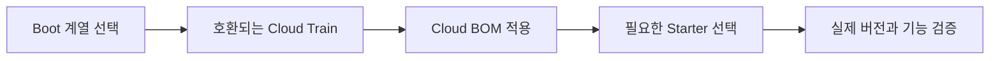

# Release Train과 Boot 버전

Spring Cloud 프로젝트는 각각 다른 버전으로 배포됩니다.
Gateway, Netflix와 Circuit Breaker에 같은 숫자를 적는다고 호환되는 조합이 되지는 않습니다.
Release Train은 함께 사용할 프로젝트들의 버전 조합을 관리하는 배포 묶음입니다.

## 세 종류의 버전을 구분합니다

| 버전 | 예시 | 의미 |
|---|---|---|
| Spring Boot | 3.5.x, 4.1.x | 애플리케이션 기반과 자동 설정 계열입니다. |
| Spring Cloud Release Train | 2025.0.x, 2025.1.x | Cloud 프로젝트들의 조합을 고르는 버전입니다. |
| 개별 프로젝트 | Gateway 4.3.x, Circuit Breaker 3.3.x | 각 기능의 실제 라이브러리 버전입니다. |

위 예시는 버전의 종류를 비교하기 위한 것이며 모두 현재 신규 도입 권장 버전이라는 뜻은 아닙니다.
호환되는 계열과 현재 지원 중인 계열은 다른 정보입니다.



## 호환성과 지원 종료를 함께 확인합니다

2026년 11월 19일 확인한 [공식 호환표](https://spring.io/projects/spring-cloud/)에서는 Boot 3.5.x에 Cloud 2025.0.x, Boot 4.0.x 및 조건에 맞는 4.1.x에 Cloud 2025.1.x를 연결합니다.
같은 표는 2025.0.x 등 일부 과거 Train에 지원 종료 표시를 함께 제공합니다.
따라서 과거 프로젝트의 조합을 해석하는 기준으로 쓰는 것과 신규 운영 버전을 선택하는 것은 구분합니다.

지원 정책은 변경될 수 있으므로 이 글의 숫자만 복사해 장기간 유지하지 않습니다.
[공식 세대별 호환 정보](https://spring.io/projects/generations)와 [Cloud 지원 페이지](https://spring.io/projects/spring-cloud/#support)를 확인합니다.
[Supported Versions 위키](https://github.com/spring-cloud/spring-cloud-release/wiki/Supported-Versions)는 자체적으로 최신 공식 정보의 위치도 안내하므로 그 안내를 함께 읽습니다.

이 아카이브의 일반 Spring 예제가 Boot 3.5를 기준으로 설명하는 것은 학습 코드의 API 범위입니다.
해당 계열의 운영 지원과 보안 패치를 보장하는 선언은 아닙니다.
실제 프로젝트의 업그레이드는 테스트와 배포 호환성 검증을 별도로 수행합니다.

## BOM은 의존성을 모두 추가하지 않습니다

BOM은 Bill of Materials의 약자로, 여기서는 사용할 라이브러리 버전을 관리하는 목록입니다.
BOM을 가져와도 Gateway나 Eureka가 전부 앱에 포함되지는 않습니다.
기능은 필요한 Starter를 따로 추가합니다.

다음은 공식 페이지에서 확인한 계열을 바탕으로 한 Gradle Groovy DSL 구성 예제입니다.
기존 앱을 이 버전으로 전환해 검증한 결과가 아니라 버전 관리 위치를 보여 주는 예제입니다.

```groovy
plugins {
    id 'java'
    id 'org.springframework.boot' version '4.1.2'
    id 'io.spring.dependency-management' version '1.1.7'
}

repositories {
    mavenCentral()
}

ext {
    set('springCloudVersion', '2025.1.4')
}

dependencyManagement {
    imports {
        mavenBom "org.springframework.cloud:spring-cloud-dependencies:${springCloudVersion}"
    }
}

dependencies {
    implementation 'org.springframework.cloud:spring-cloud-starter-config'
}
```

Boot 플러그인 버전과 Cloud BOM 버전이 서로 다른 위치에 있다는 점이 핵심입니다.
사용 중인 Cloud Starter의 버전을 임의로 덮어쓰면 BOM이 정한 조합에서 벗어날 수 있습니다.
외부 클라우드 통합 프로젝트는 자체 BOM과 호환표가 있을 수 있으므로 별도 기준을 확인합니다.

## 실제로 선택된 버전을 확인합니다

```bash
./gradlew dependencies --configuration runtimeClasspath
./gradlew dependencyInsight --dependency spring-cloud-commons --configuration runtimeClasspath
```

첫 명령은 전체 의존성 경로를, 두 번째는 공통 라이브러리의 선택 버전을 확인합니다.
멀티 프로젝트에서는 `:app:dependencyInsight`처럼 실제 대상 앱의 태스크를 사용합니다.
루트에 BOM을 선언해도 하위 프로젝트가 그 설정을 적용하지 않았다면 기대한 버전 관리가 되지 않을 수 있습니다.

Cloud의 호환성 검사에서 기동 오류가 발생하면 Boot와 Train 조합 및 실제 의존성부터 확인합니다.
검사 기능을 끄는 것은 검증되지 않은 조합의 호환성을 만들어 주지 않습니다.

## 버전 변경의 검증 범위

기동 성공 외에도 Config 조회, 서비스 등록과 주소 선택, Gateway 필터 및 메시징의 주요 경로를 확인합니다.
설정 키와 Starter 이름, 자동 설정 조건은 세대별로 달라질 수 있습니다.
보안 패치가 포함된 런타임과 라이브러리인지도 각각 확인합니다.

버전 변경 기록에는 Boot, Cloud Train, 사용한 주요 프로젝트와 JDK를 함께 남깁니다.
배포 이미지와 설정까지 연결하면 이전 조합으로 복구할 때 필요한 정보도 찾기 쉽습니다.

## 자주 묻는 질문

### 세 종류의 버전을 구분합니다에서 무엇을 확인하나요?

최소 설정으로 동작을 확인한 뒤 확장합니다. 성공과 실패를 경로별로 기록합니다.

### 호환성과 지원 종료를 함께 확인합니다에서 무엇을 확인하나요?

최소 설정으로 동작을 확인한 뒤 확장합니다. 성공과 실패를 경로별로 기록합니다.
